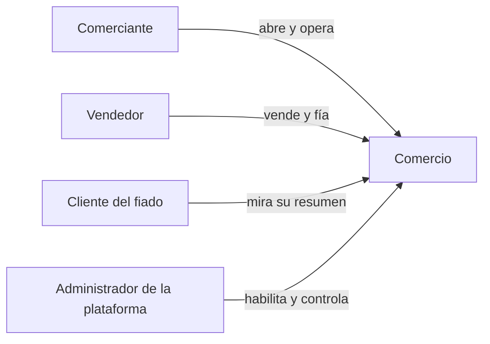

# Descripción general

**Confiabilidad:** 🟡 preliminar

**Propósito:** Que cualquier comercio de barrio venda, controle su stock y fíe desde el celular, con una aplicación que se siente como una app y se entiende sin manual.

**Contexto**

Despensa es una plataforma donde cada comercio tiene su propio espacio: su nombre, su imagen, su tema y su catálogo. Un comerciante se registra solo, elige su rubro y arranca con un catálogo armado para ese rubro —verdulería, ferretería, almacén, carnicería—, y desde ese momento cobra, descuenta stock y lleva la cuenta corriente de sus clientes.

Los datos de un comercio no se mezclan con los de otro: el mismo sistema atiende a muchos comercios a la vez, pero cada uno ve sólo lo suyo. Por encima de todos está el administrador de la plataforma, que habilita los rubros, mantiene los catálogos por defecto y puede suspender un comercio.

La aplicación es mobile-first y se usa de pie, en el mostrador, muchas veces con una sola mano. Está pensada para personas mayores: textos grandes, botones grandes, una acción principal por pantalla y nada escondido detrás de gestos.

**Queda afuera de esta versión:** facturación electrónica e impresión fiscal, cobros con tarjeta dentro de la aplicación, entregas a domicilio, tienda en línea para el cliente final y envío automático de mensajes (el resumen del fiado se comparte por WhatsApp, no se envía desde el sistema).

## note-001 - Pensada para personas mayores

**Nota funcional de IA** · **Confiabilidad:** 🟡 preliminar

Toda pantalla se lee sin agrandar la letra y se opera sin apuntar fino: los textos y los botones son grandes, la acción principal de cada pantalla está a la vista y siempre en el mismo lugar, y ninguna función importante queda escondida detrás de un gesto, de un doble toque o de un menú de tres puntos.

Las confirmaciones se piden con una frase completa y dos botones que dicen qué hacen («Cobrar $ 12.500», «Cancelar»), nunca «Sí» y «No». Los errores se explican con lo que hay que hacer y no con el nombre del problema. Las listas muestran pocos datos por renglón, con la información que se usa en el mostrador: nombre, precio y existencia.

## note-002 - Un comercio, una cuenta

**Nota funcional de IA** · **Confiabilidad:** 🟡 preliminar

_Supuesto sin confirmar (2026-11-16): una cuenta de acceso pertenece a un solo comercio. Quien tiene dos locales usa dos cuentas, con dos correos distintos, hasta que se pida lo contrario._

Consecuencia de ese supuesto: el correo electrónico identifica a la persona en toda la plataforma y no se repite; un vendedor que trabaja en dos comercios necesita dos cuentas.

# Roles

## role-001 - Comerciante

**Confiabilidad:** 🟡 preliminar

**Qué es:** La persona dueña del comercio, que lo abre en la plataforma y responde por él.

**Responsabilidades**

Se registra, completa el primer ingreso con el nombre, la imagen, el tema y el rubro, y desde ahí administra todo lo suyo: el catálogo, los precios, el stock, los clientes, las ventas, los gastos y quiénes entran al sistema. Decide a quién le fía y puede suspender el fiado de un cliente. No ve los datos de otros comercios ni puede cambiar los rubros de la plataforma.

## role-002 - Vendedor

**Confiabilidad:** 🟡 preliminar

**Qué es:** La persona que atiende el mostrador y cobra en nombre del comercio.

**Responsabilidades**

Cobra, fía, registra abonos, consulta precios y existencias y carga clientes nuevos sin salir del cobro. Ve el catálogo completo y las ventas del día, pero no cambia la configuración del comercio, no elige el tema, no da de alta ni de baja a otras personas y no toca los gastos. _Supuesto sin confirmar (2026-11-16): el vendedor no ve el total de gastos del comercio._

## role-003 - Administrador de la plataforma

**Confiabilidad:** 🟡 preliminar

**Qué es:** La cuenta que está por encima de todos los comercios y cuida el orden de la plataforma.

**Responsabilidades**

Ve el listado de comercios, entra a ver cómo trabajan, suspende a quien incumple y lo reactiva cuando corresponde. Mantiene los rubros y el catálogo con el que arranca cada rubro nuevo. No vende, no fía y no modifica los datos de un comercio: cuando algo hay que corregir adentro, lo hace el comerciante.

## role-004 - Cliente del fiado

**Confiabilidad:** 🟡 preliminar

**Qué es:** La persona a la que el comercio le fió y que recibe por WhatsApp el resumen de su cuenta.

**Responsabilidades**

Mira lo que compró, lo que pagó y lo que debe, en el momento que quiera y sin instalar nada. No tiene usuario ni contraseña, no carga datos y no modifica nada: el link que recibe es de sólo lectura y muestra únicamente su cuenta con ese comercio.

# Dominio global

## domain-001 - Comercio

**Confiabilidad:** 🟡 preliminar

**Qué es:** El espacio de un comercio dentro de la plataforma, con todo lo que le pertenece.

**Estructura**

Nace cuando alguien se registra, con una cuenta de acceso a nombre de esa persona, un rubro elegido y un catálogo inicial copiado de ese rubro. Guarda su nombre, su imagen y su tema, y adentro cuelgan sus productos, sus categorías, sus clientes, sus ventas, sus cuentas corrientes y sus gastos. Su estado es *habilitado* o *suspendido*; el primer ingreso, mientras no se completa, es un estado aparte del comercio, no de la persona.

Nada de lo que hay adentro de un comercio se comparte con otro, y ningún comercio ve el nombre de otro desde su panel.

### rule-001 - Cada comercio ve sólo lo suyo

**Confiabilidad:** 🟡 preliminar

**Regla:** Todo lo que un comercio carga —productos, clientes, ventas, cuentas, gastos— le pertenece sólo a él y no aparece en ningún otro comercio.
**Por qué:** Dos almacenes de barrio son competencia directa: si se mezclan los clientes o los precios, el sistema deja de ser confiable y nadie lo usa.

### rule-002 - Un comercio se suspende, no se borra

**Confiabilidad:** 🟡 preliminar

**Regla:** Cuando la plataforma frena un comercio, lo deja suspendido: nadie entra, pero el catálogo, los clientes, las ventas y las deudas siguen guardados y vuelven a la vista al reactivarlo.
**Por qué:** Borrar un comercio borra las deudas de sus clientes y las ventas que respaldan lo que se cobró; nada de eso se puede reconstruir después.

## domain-002 - Rubro

**Confiabilidad:** 🟡 preliminar

**Qué es:** La actividad del comercio —verdulería, ferretería, almacén, carnicería— que decide con qué catálogo arranca.

**Estructura**

Cada rubro trae un conjunto de categorías y productos sugeridos, con su unidad de venta y sin precio. La plataforma mantiene ese conjunto y puede sumar rubros nuevos; el comercio que lo elige recibe una copia y desde ahí edita, agrega y da de baja lo que quiera, sin afectar a los demás ni al rubro.

### rule-003 - El rubro define el catálogo inicial, no el definitivo

**Confiabilidad:** 🟡 preliminar

**Regla:** El catálogo que llega con el rubro es un punto de partida: el comercio lo edita libremente y sus cambios no vuelven al rubro ni llegan a otros comercios.
**Por qué:** Ningún catálogo genérico cubre lo que vende un almacén de barrio; si el comercio no puede ajustarlo, termina vendiendo con nombres y precios que no son los suyos.

# Procesos globales

## process-001 - Abrir un comercio y llegar a la primera venta

**Confiabilidad:** 🟡 preliminar

**Propósito:** Llevar a una persona desde el registro hasta el primer cobro, sin ayuda de nadie.

**Contexto**

Empieza cuando alguien crea su cuenta y termina con la primera venta cobrada y el stock descontado. El primer ingreso es el único paso que no se puede saltear: hasta que el comercio no tiene nombre, imagen, tema y rubro, no entra al panel.

**Recorrido**

1. La persona crea su cuenta de acceso → [[#use-case-004 - Registrarse como comercio]]
2. El comercio completa el primer ingreso: nombre, imagen, tema y rubro → [[#use-case-009 - Ponerle nombre al comercio]] · [[#use-case-010 - Elegir la imagen del comercio]] · [[#use-case-011 - Elegir el tema]] · [[#use-case-012 - Elegir el rubro y recibir el catálogo]]
3. El comercio revisa el catálogo que recibió y ajusta precios → [[#use-case-014 - Editar un producto y su precio]]
4. El comercio cobra la primera venta → [[#use-case-028 - Cobrar una venta]]

### rule-004 - No se cobra sin completar el primer ingreso

**Confiabilidad:** 🟡 preliminar

**Regla:** Mientras el comercio no tenga nombre, imagen, tema y rubro, no entra al panel y no puede cobrar.
**Por qué:** Un comercio sin identidad ni catálogo no tiene nada que vender, y el resumen del fiado saldría sin nombre ni imagen.

## process-002 - Supervisar los comercios de la plataforma

**Confiabilidad:** 🟡 preliminar

**Propósito:** Que quien administra la plataforma sepa qué comercios hay, cómo trabajan y pueda frenar a uno sin destruir sus datos.

**Contexto**

Arranca con el listado de comercios y sigue cuando uno llama la atención por tamaño, por reclamo o por inactividad. La suspensión es la única intervención fuerte y siempre se puede revertir.

**Recorrido**

1. El administrador de la plataforma consulta los comercios → [[#use-case-052 - Consultar los comercios]]
2. Entra a ver la actividad de uno → [[#use-case-053 - Consultar la actividad de un comercio]]
3. Si corresponde, lo suspende → [[#use-case-054 - Suspender un comercio]]
4. Cuando se resuelve, lo reactiva → [[#use-case-055 - Reactivar un comercio]]

### rule-005 - Toda suspensión se revierte

**Confiabilidad:** 🟡 preliminar

**Regla:** Un comercio suspendido se puede reactivar en cualquier momento y vuelve exactamente al estado en que estaba.
**Por qué:** Una suspensión por error dejaría a un comercio sin poder cobrar y a sus clientes sin poder ver sus deudas; tiene que tener vuelta atrás.

# Módulos

## Módulo ACC - Acceso y cuentas

**Confiabilidad:** 🟡 preliminar

**Propósito:** Que cada persona entre a su comercio con su propia cuenta y que el comercio decida quién más puede entrar y qué puede hacer.

**Contexto**

El registro crea a la vez la cuenta de acceso y el comercio; desde ese momento el dueño suma vendedores. Una cuenta pertenece a un solo comercio y tiene un rol adentro. El cliente del fiado no tiene cuenta: mira su resumen por un link abierto.

### Dominio

#### domain-003 - Cuenta de acceso

**Confiabilidad:** 🟡 preliminar

**Qué es:** La credencial con la que una persona entra al sistema y firma lo que hace.

**Estructura**

Se identifica por un correo electrónico único en toda la plataforma y una contraseña de al menos ocho caracteres. Pertenece a un comercio, tiene un rol adentro y está *activa* o *inactiva*. La cuenta guarda el nombre de la persona, que es el que aparece como responsable de una venta o de un abono. Una cuenta inactiva no puede entrar, pero lo que hizo sigue figurando con su nombre.

##### rule-006 - Un correo, una cuenta

**Confiabilidad:** 🟡 preliminar

**Regla:** Un correo electrónico identifica a una sola cuenta en toda la plataforma y no se puede repetir, ni siquiera entre comercios distintos.
**Por qué:** El correo es lo único que la persona recuerda cuando vuelve a entrar; si se repite, el sistema no sabe a qué comercio hacerla entrar.

##### rule-007 - El último dueño activo no se puede dar de baja

**Confiabilidad:** 🟡 preliminar

**Regla:** Un comercio siempre conserva al menos una cuenta activa con rol de dueño; la baja del último se rechaza.
**Por qué:** Sin dueño, nadie puede sumar vendedores, cambiar el catálogo ni tocar la configuración, y el comercio queda abandonado sin poder recuperarse solo.

##### rule-008 - Una cuenta desactivada conserva lo que hizo

**Confiabilidad:** 🟡 preliminar

**Regla:** Al desactivar una cuenta, sus ventas, abonos y cambios siguen figurando a su nombre y la cuenta no se borra.
**Por qué:** «Cobró alguien que ya no trabaja acá» es una respuesta que el comerciante necesita poder dar; si el nombre desaparece, la venta queda sin responsable.

#### domain-004 - Rol dentro del comercio

**Confiabilidad:** 🟡 preliminar

**Qué es:** Lo que una cuenta puede hacer adentro de su comercio: dueño (`dueno`) o vendedor (`vendedor`).

**Estructura**

El dueño administra todo: catálogo, precios, stock, clientes, fiado, gastos, configuración y personal. El vendedor trabaja en el mostrador: cobra, fía, registra abonos, carga clientes y consulta precios y existencias; no cambia la configuración, no toca los gastos y no da de alta ni de baja a otras personas. Cada comercio nace con una sola cuenta, la del dueño.

##### rule-009 - Sólo el dueño reparte permisos

**Confiabilidad:** 🟡 preliminar

**Regla:** Sólo una cuenta con rol de dueño suma vendedores, cambia roles y da de baja cuentas; el vendedor no puede darse permisos a sí mismo ni a otro.
**Por qué:** Si cualquier cuenta pudiera repartir accesos, un vendedor podría crear una cuenta a su nombre y seguir cobrando después de irse.

### Escenarios

#### ui-001 - Ingreso y registro

**Confiabilidad:** 🟡 preliminar

**Descripción**

Una sola pantalla para entrar y otra para crear la cuenta. El ingreso pide correo y contraseña, con el botón grande de entrar y el enlace de «Olvidé mi contraseña». El registro pide nombre, correo, contraseña y la confirmación de la contraseña, y avisa que después hay que completar los datos del comercio.

#### scenario-001 - Entrar al sistema

**Confiabilidad:** 🟡 preliminar

**Propósito:** Que una persona con cuenta llegue a su panel sin ayuda.
**Dirección:** Pantalla de ingreso → panel del comercio.

##### use-case-001 - Iniciar sesión

**Confiabilidad:** 🟡 preliminar

**Objetivo:** Entrar al comercio que le corresponde con el correo y la contraseña propios.
**Actor:** [[#role-001 - Comerciante]] · [[#role-002 - Vendedor]]
**Precondiciones:** La cuenta existe, está activa y su comercio no está suspendido.
**Dirección:** Pantalla de ingreso.

**Flujo principal**

1. La persona abre la aplicación y ve la pantalla de ingreso.
2. La persona escribe su correo y su contraseña.
3. El sistema valida las credenciales y busca el comercio de la cuenta.
4. El sistema deja la sesión iniciada y abre el panel del comercio.
5. Si el comercio todavía no completó el primer ingreso, el sistema lo lleva a ese asistente.

**Extensiones**

- **3a.** El correo no existe o la contraseña no coincide → el sistema avisa «El correo o la contraseña no son correctos» y no dice cuál de los dos falló (`ACC-001`).
- **3b.** La cuenta está inactiva → el sistema avisa que la cuenta fue dada de baja y no deja entrar (`ACC-002`).
- **3c.** El comercio está suspendido → el sistema avisa que el comercio está suspendido y muestra cómo contactar a la plataforma (`ACC-003`).
- **\*.** La persona olvidó la contraseña → [[#use-case-003 - Recuperar la contraseña]].

**Garantía de éxito:** La sesión queda iniciada con la cuenta y el comercio correctos, y la persona ve el panel o el asistente de primer ingreso.

##### use-case-002 - Cerrar sesión

**Confiabilidad:** 🟡 preliminar

**Objetivo:** Salir del sistema para que otra persona no siga usando la cuenta.
**Actor:** [[#role-001 - Comerciante]] · [[#role-002 - Vendedor]]
**Precondiciones:** La sesión está iniciada.
**Dirección:** Panel → menú → Cerrar sesión.

**Flujo principal**

1. La persona elige cerrar sesión.
2. El sistema pide confirmación.
3. La persona confirma.
4. El sistema cierra la sesión y vuelve a la pantalla de ingreso.

**Extensiones**

- **2a.** La persona cancela → el sistema la deja donde estaba, con la sesión abierta.

**Garantía de éxito:** La sesión queda cerrada y la pantalla de ingreso vuelve a pedir correo y contraseña.

##### use-case-003 - Recuperar la contraseña

**Confiabilidad:** 🟡 preliminar

**Objetivo:** Volver a entrar cuando la contraseña no se recuerda.
**Actor:** [[#role-001 - Comerciante]] · [[#role-002 - Vendedor]]
**Precondiciones:** La persona tiene acceso al correo con el que se registró.
**Dirección:** Pantalla de ingreso → Olvidé mi contraseña.

**Flujo principal**

1. La persona elige «Olvidé mi contraseña».
2. El sistema pide el correo de la cuenta.
3. La persona escribe su correo y confirma.
4. El sistema envía un enlace para elegir una contraseña nueva.
5. La persona abre el enlace, escribe la contraseña nueva dos veces y confirma.
6. El sistema guarda la contraseña nueva y la deja entrar.

**Extensiones**

- **4a.** El correo no corresponde a ninguna cuenta → el sistema muestra el mismo aviso de «Si el correo existe, te enviamos un enlace», sin confirmar si existe (`ACC-004`).
- **5a.** El enlace venció o ya se usó → el sistema pide pedir uno nuevo (`ACC-005`).
- **5b.** Las dos contraseñas no coinciden o tienen menos de ocho caracteres → el sistema marca el campo y no la guarda (`ACC-006`).

**Garantía de éxito:** La persona entra con su contraseña nueva y la anterior deja de funcionar.

_Supuesto sin confirmar (2026-11-16): el envío de correo está disponible en la plataforma; si no lo está, la recuperación queda en manos del administrador de la plataforma._

#### scenario-002 - Crear la cuenta del comercio

**Confiabilidad:** 🟡 preliminar

**Propósito:** Que un comercio nuevo entre a la plataforma por su cuenta, sin pedir permiso.

##### use-case-004 - Registrarse como comercio

**Confiabilidad:** 🟡 preliminar

**Objetivo:** Crear la cuenta y el comercio para empezar a trabajar en el acto.
**Actor:** [[#role-001 - Comerciante]]
**Precondiciones:** La persona no tiene cuenta en la plataforma y no hay otro comercio con ese correo.
**Dirección:** Pantalla de ingreso → Crear cuenta → asistente de primer ingreso.

**Flujo principal**

1. La persona elige «Crear cuenta».
2. El sistema pide nombre y apellido, correo, contraseña y confirmación.
3. La persona completa los datos y confirma.
4. El sistema crea la cuenta con rol de dueño y el comercio vacío, todavía sin nombre ni rubro.
5. El sistema deja la sesión iniciada y abre el asistente de primer ingreso.

**Extensiones**

- **3a.** El correo ya tiene cuenta → el sistema avisa y ofrece entrar o recuperar la contraseña (`ACC-007`).
- **3b.** La contraseña tiene menos de ocho caracteres o no coincide con la confirmación → el sistema marca el campo y no crea nada (`ACC-008`).
- **3c.** Falta el nombre o el correo no tiene forma de correo → el sistema marca el campo y no crea nada (`ACC-009`).
- **\*.** La persona abandona el registro → el sistema no crea la cuenta.

**Garantía de éxito:** La cuenta y el comercio quedan creados, la sesión iniciada y el asistente de primer ingreso abierto.

###### rule-010 - El alta no espera aprobación

**Confiabilidad:** 🟡 preliminar

**Regla:** El comercio queda habilitado en el momento en que se registra; la plataforma lo supervisa después y puede suspenderlo.
**Por qué:** Un comercio que abre un sábado a la mañana no puede quedarse esperando a que alguien de la plataforma apruebe la cuenta.

#### scenario-003 - Gestionar quiénes entran

**Confiabilidad:** 🟡 preliminar

**Propósito:** Que el dueño sume a su gente y la dé de baja cuando deja de trabajar.
**Dirección:** Menú → Personal.

##### ui-002 - Personal del comercio

**Confiabilidad:** 🟡 preliminar

**Descripción**

Listado de las cuentas del comercio con el nombre, el correo, el rol y el estado. Arriba, el botón «Sumar vendedor»; cada renglón abre la ficha de la cuenta, con el cambio de rol, la baja y el restablecimiento de la contraseña.

##### use-case-005 - Sumar un vendedor

**Confiabilidad:** 🟡 preliminar

**Objetivo:** Dar acceso a una persona que atiende el mostrador.
**Actor:** [[#role-001 - Comerciante]]
**Precondiciones:** La sesión está iniciada con rol de dueño.
**Dirección:** Personal → Sumar vendedor.

**Flujo principal**

1. El dueño abre «Sumar vendedor».
2. El sistema pide nombre, correo y una contraseña inicial.
3. El dueño completa los datos y confirma.
4. El sistema crea la cuenta con rol de vendedor, en estado activo, dentro de ese comercio.
5. El sistema muestra la cuenta en el listado y avisa que ya puede entrar.

**Extensiones**

- **4a.** El correo ya tiene cuenta → el sistema avisa que esa persona ya entra a otro comercio y no crea nada (`ACC-010`).
- **4b.** La contraseña tiene menos de ocho caracteres → el sistema marca el campo y no crea nada (`ACC-011`).
- **\*.** El dueño deja el formulario a medias → el sistema no crea la cuenta.

**Garantía de éxito:** La cuenta queda creada con rol de vendedor y esa persona entra a ese comercio con su correo.

##### use-case-006 - Cambiar el rol de una cuenta

**Confiabilidad:** 🟡 preliminar

**Objetivo:** Pasar a alguien de vendedor a dueño, o al revés, sin crear otra cuenta.
**Actor:** [[#role-001 - Comerciante]]
**Precondiciones:** La cuenta pertenece al comercio y la sesión tiene rol de dueño.
**Dirección:** Personal → ficha de la cuenta → Cambiar rol.

**Flujo principal**

1. El dueño abre la ficha de la cuenta.
2. El sistema muestra el rol actual y las dos opciones.
3. El dueño elige el rol nuevo y confirma.
4. El sistema cambia el rol y lo aplica en el siguiente ingreso de esa persona.

**Extensiones**

- **3a.** Es la única cuenta activa con rol de dueño → el sistema rechaza pasarla a vendedor (`ACC-012`).
- **3b.** La cuenta está inactiva → el sistema pide reactivarla antes de cambiar el rol.

**Garantía de éxito:** La cuenta queda con el rol nuevo y el comercio conserva al menos un dueño activo.

##### use-case-007 - Dar de baja a un vendedor

**Confiabilidad:** 🟡 preliminar

**Objetivo:** Cortar el acceso de alguien que ya no trabaja en el comercio sin perder lo que hizo.
**Actor:** [[#role-001 - Comerciante]]
**Precondiciones:** La cuenta pertenece al comercio y no es la última cuenta activa con rol de dueño.
**Dirección:** Personal → ficha de la cuenta → Dar de baja.

**Flujo principal**

1. El dueño abre la ficha de la cuenta y elige «Dar de baja».
2. El sistema avisa que la persona deja de entrar y que sus ventas quedan a su nombre.
3. El dueño confirma.
4. El sistema pasa la cuenta a inactiva.
5. El sistema conserva el nombre en las ventas y los abonos que hizo.

**Extensiones**

- **3a.** Es la última cuenta activa con rol de dueño → el sistema rechaza la baja (`ACC-013`).
- **\*.** El dueño se arrepiente → puede reactivar la cuenta desde la misma ficha.

**Garantía de éxito:** La cuenta no puede volver a entrar y el historial del comercio sigue mostrando quién hizo cada cosa.

##### use-case-008 - Cambiar mi contraseña

**Confiabilidad:** 🟡 preliminar

**Objetivo:** Reemplazar la contraseña propia por una nueva.
**Actor:** [[#role-001 - Comerciante]] · [[#role-002 - Vendedor]]
**Precondiciones:** La sesión está iniciada.
**Dirección:** Menú → Mi cuenta → Cambiar contraseña.

**Flujo principal**

1. La persona abre «Cambiar contraseña».
2. El sistema pide la contraseña actual y la nueva dos veces.
3. La persona completa los campos y confirma.
4. El sistema valida la contraseña actual y guarda la nueva.
5. El sistema avisa que el cambio se hizo y mantiene la sesión abierta.

**Extensiones**

- **4a.** La contraseña actual no coincide → el sistema avisa y no cambia nada (`ACC-014`).
- **4b.** La nueva tiene menos de ocho caracteres o no coincide con la confirmación → el sistema marca el campo (`ACC-015`).

**Garantía de éxito:** La cuenta entra con la contraseña nueva y la anterior deja de servir.

## Módulo ONB - Alta del comercio

**Confiabilidad:** 🟡 preliminar

**Propósito:** Completar en un solo paso los datos con los que el comercio se va a ver y a trabajar, sin preguntar nada que se pueda cambiar después.

**Contexto**

Es lo primero que ve una persona que acaba de crear su cuenta y lo único que no se puede saltear. Son cuatro pasos cortos: el nombre, la imagen, el tema y el rubro. Al terminar, el comercio recibe una copia del catálogo de su rubro y entra al panel con la primera venta a un toque. Todo lo que se define acá se puede cambiar después desde Configuración; el asistente no vuelve a aparecer.

### Dominio

#### domain-005 - Primer ingreso

**Confiabilidad:** 🟡 preliminar

**Qué es:** El asistente de cuatro pasos que le da identidad al comercio y su catálogo de arranque.

**Estructura**

Los pasos son nombre, imagen, tema y rubro, en ese orden, y se puede volver atrás sin perder lo cargado. Queda completo cuando los cuatro están definidos y el catálogo del rubro ya se copió; desde ese momento el comercio está habilitado para operar. Una persona que cierra la aplicación a mitad de camino vuelve al paso donde quedó y no puede entrar al panel hasta terminarlo.

##### rule-011 - El primer ingreso se hace una sola vez

**Confiabilidad:** 🟡 preliminar

**Regla:** El asistente aparece una única vez, al crear la cuenta; después, el nombre, la imagen, el tema y el rubro se cambian desde Configuración.
**Por qué:** Volver a pedir los datos en cada ingreso hace que la aplicación se sienta pesada y que la gente mayor crea que perdió lo que ya había cargado.

### Escenarios

#### ui-003 - Asistente de primer ingreso

**Confiabilidad:** 🟡 preliminar

**Descripción**

Cuatro pantallas encadenadas, una por paso, con el paso actual marcado arriba («Paso 2 de 4»), el botón grande de continuar abajo y el de volver a un costado. El tema se prueba en vivo sobre la misma pantalla, y en el paso del rubro se ve un resumen de lo que va a traer: cuántas categorías y cuántos productos.

#### scenario-004 - Primer ingreso del comercio

**Confiabilidad:** 🟡 preliminar

**Propósito:** Dejar al comercio listo para vender en menos de dos minutos.
**Dirección:** Registro → asistente de primer ingreso → panel del comercio.

##### use-case-009 - Ponerle nombre al comercio

**Confiabilidad:** 🟡 preliminar

**Objetivo:** Definir el nombre con el que el comercio se va a ver en toda la aplicación y en el resumen del fiado.
**Actor:** [[#role-001 - Comerciante]]
**Precondiciones:** La cuenta acaba de crearse y el primer ingreso está abierto en el paso 1.
**Dirección:** Asistente de primer ingreso → paso 1.

**Flujo principal**

1. El sistema muestra el paso del nombre con un campo vacío.
2. El comerciante escribe el nombre de su comercio.
3. El sistema muestra cómo va a quedar en el encabezado y en el resumen del fiado.
4. El comerciante confirma y pasa al paso de la imagen.

**Extensiones**

- **4a.** El nombre está vacío o sólo tiene espacios → el sistema no deja continuar y marca el campo (`ONB-001`).
- **\*.** El comerciante vuelve atrás desde un paso posterior → el nombre cargado sigue ahí.

**Garantía de éxito:** El comercio tiene un nombre y el asistente avanza al paso de la imagen.

##### use-case-010 - Elegir la imagen del comercio

**Confiabilidad:** 🟡 preliminar

**Objetivo:** Darle una imagen al comercio para que se reconozca de un vistazo.
**Actor:** [[#role-001 - Comerciante]]
**Precondiciones:** El paso 1 está completo.
**Dirección:** Asistente de primer ingreso → paso 2.

**Flujo principal**

1. El sistema muestra el paso de la imagen con la imagen por defecto del rubro.
2. El comerciante elige entre subir una foto de su teléfono o usar una de las imágenes sugeridas.
3. El sistema muestra la vista previa en el encabezado.
4. El comerciante confirma y pasa al paso del tema.

**Extensiones**

- **3a.** La foto no se puede subir por tamaño o formato → el sistema avisa y deja la imagen por defecto (`ONB-002`).
- **2a.** El comerciante saltea el paso → el sistema usa la imagen por defecto del rubro.
- **\*.** La imagen elegida no es cuadrada → el sistema la recorta al centro sin deformarla.

**Garantía de éxito:** El comercio tiene una imagen visible en el encabezado y el asistente avanza al paso del tema.

##### use-case-011 - Elegir el tema

**Confiabilidad:** 🟡 preliminar

**Objetivo:** Que el comercio se vea como le gusta desde el primer día.
**Actor:** [[#role-001 - Comerciante]]
**Precondiciones:** El paso 2 está completo.
**Dirección:** Asistente de primer ingreso → paso 3.

**Flujo principal**

1. El sistema muestra las siete opciones de tema con su nombre y una muestra de colores.
2. El comerciante toca una opción y ve la pantalla entera con ese tema aplicado en el acto.
3. El comerciante confirma el tema elegido y pasa al paso del rubro.

**Extensiones**

- **3a.** El comerciante no elige ninguno → el sistema continúa con el tema por defecto de la plataforma.
- **\*.** El comerciante cambia de tema las veces que quiera → el sistema sólo guarda el último.

**Garantía de éxito:** El comercio tiene un tema aplicado y el asistente avanza al paso del rubro.

##### use-case-012 - Elegir el rubro y recibir el catálogo

**Confiabilidad:** 🟡 preliminar

**Objetivo:** Arrancar con los productos del rubro ya cargados, sin escribir uno por uno.
**Actor:** [[#role-001 - Comerciante]]
**Precondiciones:** Los pasos 1 a 3 están completos.
**Dirección:** Asistente de primer ingreso → paso 4 → panel del comercio.

**Flujo principal**

1. El sistema muestra los rubros disponibles con una descripción y el resumen de lo que trae cada uno.
2. El comerciante elige su rubro y confirma que es el correcto.
3. El sistema copia las categorías y los productos del rubro, sin precios y con existencia en cero.
4. El sistema guarda el comercio como completo y abre el panel.
5. El sistema muestra un aviso con lo que quedó cargado y el camino para revisar precios.

**Extensiones**

- **2a.** El comerciante no encuentra su rubro → el sistema ofrece arrancar con el catálogo mínimo de almacén y avisa que puede cargar sus productos a mano (`ONB-003`).
- **3a.** Los productos del rubro ya estaban copiados por un intento anterior → el sistema no los duplica.
- **\*.** El comerciante cierra la aplicación en este paso → al volver, el asistente lo espera en el paso 4.

**Garantía de éxito:** El comercio queda completo, con el catálogo del rubro copiado y el panel abierto en el inicio.

###### rule-012 - El catálogo del rubro llega sin precio

**Confiabilidad:** 🟡 preliminar

**Regla:** Los productos que trae el rubro se copian con su nombre, su categoría y su unidad, sin precio y con existencia en cero.
**Por qué:** Un precio puesto por la plataforma sería un precio que el comerciante no decidió, y venderlo así le haría perder plata sin darse cuenta.

## Módulo CAT - Catálogo y stock

**Confiabilidad:** 🟡 preliminar

**Propósito:** Tener a mano todo lo que el comercio vende, con su precio y su existencia, para cobrar rápido y no vender lo que no hay.

**Contexto**

El catálogo es la lista de lo que el comercio vende, agrupada en categorías. Cada producto tiene un precio y una existencia que el comercio mantiene al día; el precio puede quedar sin definir y se completa antes de la primera venta. La existencia baja sola con cada venta y se corrige a mano cuando entra mercadería o cuando algo se rompe. El catálogo es la fuente de la que se eligen los renglones al cobrar y la que responde «¿cuánto sale?» desde el mostrador.

### Dominio

#### domain-006 - Producto

**Confiabilidad:** 🟡 preliminar

**Qué es:** Cada cosa que el comercio vende, con su precio y su existencia.

**Estructura**

Tiene un nombre, una marca opcional, una categoría, una unidad de venta, un precio y una existencia. Su estado es *activo* o *inactivo*. El precio puede estar vacío —se muestra como «Sin precio»— y en ese caso el producto existe pero no se puede cobrar hasta completarlo. La existencia se expresa en milésimas de unidad para admitir peso y volumen, y se muestra redondeada según la unidad.

##### rule-013 - Un producto sin precio no se puede vender

**Confiabilidad:** 🟡 preliminar

**Regla:** Un producto con el precio vacío no se puede agregar al carrito; al intentarlo, el sistema pide completar el precio en el momento.
**Por qué:** Cobrar un producto a cero por falta de precio es una pérdida que nadie nota hasta que cierra la caja.

##### rule-014 - El producto inactivo no se vende

**Confiabilidad:** 🟡 preliminar

**Regla:** Un producto inactivo no aparece en el buscador del cobro ni se puede agregar a una venta; sus ventas anteriores se conservan.
**Por qué:** Lo que el comercio dejó de vender no puede colarse en el mostrador por un descuido ni ensuciar la búsqueda de quien cobra.

#### domain-007 - Categoría

**Confiabilidad:** 🟡 preliminar

**Qué es:** El grupo al que pertenece un producto, para encontrar más rápido en el catálogo.

**Estructura**

Tiene un nombre único dentro del comercio y un estado *activa* o *inactiva*. Agrupa productos y ordena el catálogo, pero no cambia el precio ni la existencia de nada. Un producto pertenece a una sola categoría.

##### rule-015 - El nombre de la categoría es único en el comercio

**Confiabilidad:** 🟡 preliminar

**Regla:** No puede haber dos categorías con el mismo nombre dentro de un comercio, sin importar mayúsculas ni acentos.
**Por qué:** Dos categorías «Bebidas» parten el catálogo en dos y ninguna de las dos muestra todo lo que debería.

#### domain-008 - Existencia

**Confiabilidad:** 🟡 preliminar

**Qué es:** Cuánto hay de cada producto en el momento.

**Estructura**

Es un número en milésimas de unidad, con su equivalente visible según la unidad del producto. Baja con cada venta y sube o baja con los ajustes que hace el comercio, cada uno con su motivo y con el nombre de quien lo hizo. Su historial permite reconstruir por qué un producto está en el número que está.

##### rule-016 - La existencia nunca queda negativa

**Confiabilidad:** 🟡 preliminar

**Regla:** Una venta no puede dejar la existencia de un producto por debajo de cero; si no alcanza, el sistema lo avisa antes de cobrar.
**Por qué:** Una existencia negativa esconde una venta mal cargada o una reposición que no se registró, y el comercio sigue vendiendo sobre un número que no existe.

##### rule-017 - Todo ajuste de existencia dice por qué

**Confiabilidad:** 🟡 preliminar

**Regla:** Cada cambio manual de existencia pide un motivo —reposición, rotura, recuento o error de carga— y queda registrado con el nombre de quien lo hizo.
**Por qué:** Sin el motivo, un número que cambió solo no se puede explicar y el comerciante desconfía del stock.

#### domain-009 - Unidad de venta

**Confiabilidad:** 🟡 preliminar

**Qué es:** La forma en que se mide un producto: por unidad, por peso o por volumen.

**Estructura**

Cada producto se vende en una de tres unidades: *unidad*, *kilogramo* o *litro*. La unidad decide si el comercio puede vender fracciones y cómo se muestra la cantidad en el carrito y en el ticket.

##### rule-018 - Sólo peso y volumen admiten fracciones

**Confiabilidad:** 🟡 preliminar

**Regla:** Los productos por unidad se venden en cantidades enteras; sólo los que se venden por kilogramo o por litro admiten fracciones.
**Por qué:** Media lata o tres cuartos de un tornillo no existen en el mostrador, y una cantidad fraccionaria deja el stock en un número imposible de contar.

### Escenarios

#### ui-004 - Catálogo

**Confiabilidad:** 🟡 preliminar

**Descripción**

Listado de productos con búsqueda arriba, el filtro por categoría y el filtro por estado. Cada renglón muestra nombre, precio y existencia, y abre la ficha del producto para editar. El botón «Nuevo producto» queda fijo abajo, al alcance del pulgar, y al costado el acceso a las categorías.

#### scenario-005 - Armar el catálogo

**Confiabilidad:** 🟡 preliminar

**Propósito:** Cargar, ordenar y mantener lo que el comercio vende.

##### use-case-013 - Crear un producto

**Confiabilidad:** 🟡 preliminar

**Objetivo:** Sumar al catálogo algo que el comercio vende.
**Actor:** [[#role-001 - Comerciante]] · [[#role-002 - Vendedor]]
**Precondiciones:** La sesión está iniciada y el comercio completó el primer ingreso.
**Dirección:** Catálogo → Nuevo producto.

**Flujo principal**

1. La persona abre «Nuevo producto».
2. El sistema pide nombre, categoría, unidad, precio y existencia inicial.
3. La persona completa los datos y confirma.
4. El sistema valida el nombre y la categoría y crea el producto activo.
5. El sistema lo muestra en el catálogo y deja listo el alta del siguiente.

**Extensiones**

- **4a.** Falta el nombre o la categoría → el sistema marca el campo y no crea el producto (`CAT-001`).
- **4b.** Ya existe un producto activo con ese nombre y esa marca → el sistema avisa y ofrece abrir el existente (`CAT-002`).
- **3a.** El precio se deja vacío → el sistema crea el producto como «Sin precio» y avisa que no se podrá vender hasta completarlo.
- **3b.** La unidad es kilogramo o litro y la existencia inicial no es un número válido → el sistema marca el campo (`CAT-003`).

**Garantía de éxito:** El producto queda activo en el catálogo, con su categoría y su unidad, y aparece en la búsqueda del cobro.

##### use-case-014 - Editar un producto y su precio

**Confiabilidad:** 🟡 preliminar

**Objetivo:** Corregir los datos de un producto o ponerle el precio que faltaba.
**Actor:** [[#role-001 - Comerciante]] · [[#role-002 - Vendedor]]
**Precondiciones:** El producto existe en el catálogo del comercio.
**Dirección:** Catálogo → producto → Editar.

**Flujo principal**

1. La persona abre la ficha del producto.
2. El sistema muestra los datos actuales, con el precio y la existencia a la vista.
3. La persona cambia lo que necesita y confirma.
4. El sistema guarda los cambios y los aplica en el siguiente cobro.
5. Si cambió el precio, sólo las ventas nuevas lo toman; las anteriores conservan el suyo.

**Extensiones**

- **3a.** El precio se escribe en cero → el sistema lo rechaza y pide un precio mayor a cero o dejarlo vacío (`CAT-004`).
- **3b.** El nombre queda vacío o la categoría se borra → el sistema marca el campo (`CAT-005`).
- **\*.** El cambio de precio afecta a un producto que está en un carrito abierto → el sistema avisa que el carrito mantiene el precio anterior.

**Garantía de éxito:** El producto queda con los datos nuevos y el catálogo y el cobro usan el precio vigente.

##### use-case-015 - Dar de alta una categoría

**Confiabilidad:** 🟡 preliminar

**Objetivo:** Agrupar productos para encontrarlos más rápido.
**Actor:** [[#role-001 - Comerciante]]
**Precondiciones:** La sesión está iniciada con rol de dueño.
**Dirección:** Catálogo → Categorías → Nueva categoría.

**Flujo principal**

1. El dueño abre las categorías y elige «Nueva categoría».
2. El sistema pide el nombre.
3. El dueño escribe el nombre y confirma.
4. El sistema valida que no exista otra igual y la crea activa.
5. La categoría queda disponible para asignar productos.

**Extensiones**

- **4a.** Ya existe una categoría con ese nombre → el sistema avisa y no la crea (`CAT-006`).
- **4b.** El nombre está vacío → el sistema marca el campo (`CAT-007`).

**Garantía de éxito:** La categoría queda activa y se puede elegir al crear o editar un producto.

##### use-case-016 - Dar de baja un producto

**Confiabilidad:** 🟡 preliminar

**Objetivo:** Sacar del mostrador algo que el comercio dejó de vender, sin perder su historial.
**Actor:** [[#role-001 - Comerciante]]
**Precondiciones:** El producto existe y está activo.
**Dirección:** Catálogo → producto → Dar de baja.

**Flujo principal**

1. El dueño abre la ficha del producto y elige «Dar de baja».
2. El sistema avisa que el producto deja de aparecer en el cobro y que sus ventas se conservan.
3. El dueño confirma.
4. El sistema pasa el producto a inactivo y lo saca de la búsqueda del cobro.

**Extensiones**

- **\*.** El producto tiene existencia → el sistema avisa cuánto queda y sugiere ajustarla antes de la baja.
- **\*.** El dueño se arrepiente → puede reactivarlo desde el filtro de inactivos.

**Garantía de éxito:** El producto no se puede vender y sus ventas anteriores lo siguen mostrando con el nombre y el precio del momento.

#### scenario-006 - Consultar y reponer stock

**Confiabilidad:** 🟡 preliminar

**Propósito:** Que la existencia que ve el mostrador sea la que hay en el estante.

##### ui-005 - Ajuste de existencia

**Confiabilidad:** 🟡 preliminar

**Descripción**

Pantalla de un solo producto: la existencia actual en grande, el campo para el número nuevo o para sumar o restar, los cuatro motivos de ajuste y una nota opcional. Abajo, el historial de los últimos ajustes con fecha, motivo y nombre de quien lo hizo.

##### use-case-017 - Consultar la existencia

**Confiabilidad:** 🟡 preliminar

**Objetivo:** Saber cuánto hay de un producto antes de prometerlo.
**Actor:** [[#role-001 - Comerciante]] · [[#role-002 - Vendedor]]
**Precondiciones:** El producto existe en el catálogo.
**Dirección:** Catálogo → producto · Catálogo → filtro «Sin stock».

**Flujo principal**

1. La persona busca el producto en el catálogo.
2. El sistema muestra la existencia en la unidad del producto y su estado: con stock, stock bajo o sin stock.
3. La persona puede filtrar el catálogo para ver sólo lo que está por agotarse.

**Extensiones**

- **2a.** La existencia es cero → el sistema muestra «Sin stock» en rojo y no deja agregarlo al carrito (`CAT-008`).

**Garantía de éxito:** La persona ve la existencia vigente y el catálogo marca lo que está por agotarse.

##### use-case-018 - Ajustar la existencia a mano

**Confiabilidad:** 🟡 preliminar

**Objetivo:** Corregir la existencia cuando entra mercadería, se rompe algo o el recuento no coincide.
**Actor:** [[#role-001 - Comerciante]] · [[#role-002 - Vendedor]]
**Precondiciones:** El producto existe y está activo.
**Dirección:** Catálogo → producto → Ajustar existencia.

**Flujo principal**

1. La persona abre el ajuste de existencia.
2. El sistema muestra cuánto hay y pide el número nuevo o cuánto sumar o restar.
3. La persona elige el motivo —reposición, rotura, recuento o error de carga— y, si quiere, escribe una nota.
4. El sistema guarda el ajuste con el nombre de quien lo hizo y la fecha.
5. El sistema muestra la existencia nueva y el ajuste en el historial.

**Extensiones**

- **3a.** No se elige motivo → el sistema no deja guardar (`CAT-009`).
- **4a.** El ajuste deja la existencia en negativo → el sistema lo rechaza (`CAT-010`).
- **\*.** El ajuste es por reposición → el sistema sugiere cargar el motivo con la nota «Compra a proveedor».

**Garantía de éxito:** La existencia coincide con lo que hay y el cambio queda explicado con su motivo, su fecha y su responsable.

#### scenario-007 - Consultar el precio

**Confiabilidad:** 🟡 preliminar

**Propósito:** Responder «¿cuánto sale?» en el mostrador en dos toques.

##### use-case-019 - Buscar un producto por nombre

**Confiabilidad:** 🟡 preliminar

**Objetivo:** Encontrar un producto del catálogo escribiendo parte del nombre.
**Actor:** [[#role-001 - Comerciante]] · [[#role-002 - Vendedor]]
**Precondiciones:** El catálogo tiene productos activos.
**Dirección:** Inicio → Consultar precio.

**Flujo principal**

1. La persona abre «Consultar precio» y el cursor queda en el buscador.
2. La persona escribe las primeras letras del nombre.
3. El sistema filtra el catálogo mientras se escribe y muestra nombre, marca y precio de cada coincidencia.
4. La persona toca un resultado y ve el precio y la existencia en grande.

**Extensiones**

- **3a.** No hay coincidencias → el sistema ofrece cargar un producto nuevo si la persona es dueña (`CAT-011`).
- **\*.** La persona borra lo escrito → el sistema vuelve a la lista completa de activos.

**Garantía de éxito:** La persona encuentra el producto por nombre y ve su precio vigente.

##### use-case-020 - Consultar el precio y la existencia

**Confiabilidad:** 🟡 preliminar

**Objetivo:** Ver el precio final de un producto, con su unidad, y si hay.
**Actor:** [[#role-001 - Comerciante]] · [[#role-002 - Vendedor]]
**Precondiciones:** El producto está activo.
**Dirección:** Consultar precio → producto.

**Flujo principal**

1. La persona abre un producto desde el buscador.
2. El sistema muestra el precio con el signo de peso, la unidad —«por kilogramo», «por unidad»— y la existencia.
3. Si el producto no tiene precio, el sistema lo dice y ofrece completarlo.
4. La persona vuelve al buscador para consultar otro.

**Extensiones**

- **2a.** El producto no tiene precio → el sistema muestra «Sin precio» y el botón «Poner precio» para quien puede editarlo (`CAT-012`).
- **2b.** El producto no tiene existencia → el sistema muestra «Sin stock» junto al precio.

**Garantía de éxito:** La persona ve el precio final y la disponibilidad sin abrir el catálogo completo.

## Módulo CLI - Clientes

**Confiabilidad:** 🟡 preliminar

**Propósito:** Guardar la ficha de cada cliente para venderle y, sobre todo, para fiarle y acordarse de quién es.

**Contexto**

La ficha del cliente es del comercio, no una cuenta de acceso: el cliente nunca entra al sistema. Se puede crear antes de vender o en pleno cobro, sin salir del carrito. El nombre alcanza para fiar; el teléfono es lo que permite mandarle el resumen de su cuenta por WhatsApp. La ficha también guarda una calificación de una a cinco estrellas y un comentario libre, para que el comerciante recuerde cómo viene pagando esa persona.

### Dominio

#### domain-010 - Cliente

**Confiabilidad:** 🟡 preliminar

**Qué es:** La ficha de una persona que compra en el comercio, con lo necesario para atenderla y fiarle.

**Estructura**

Tiene nombre y apellido, un apodo opcional, teléfono, dirección, alias para transferencias, una calificación de una a cinco estrellas, un comentario y un estado *activo* o *inactivo*. Puede tener una cuenta corriente con el comercio, que es la que dice cuánto debe. Su ficha es la que se abre al cobrar para elegir a quién se le fía y la que se comparte por WhatsApp cuando pide su resumen.

##### rule-019 - Toda ficha tiene un nombre

**Confiabilidad:** 🟡 preliminar

**Regla:** Un cliente se crea con nombre o apodo; sin uno de los dos no se guarda la ficha.
**Por qué:** Una deuda sin nombre no se puede cobrar ni reclamar: nadie sabe a quién buscar.

##### rule-020 - Un cliente con deuda no se borra

**Confiabilidad:** 🟡 preliminar

**Regla:** Un cliente con saldo pendiente se puede desactivar, pero no se borra; su deuda y sus movimientos siguen disponibles.
**Por qué:** Borrar la ficha borra la prueba de lo que se fió y de lo que se cobró, y la deuda queda sin responsable.

### Escenarios

#### ui-006 - Clientes

**Confiabilidad:** 🟡 preliminar

**Descripción**

Listado de clientes con buscador arriba y filtro por estado. Cada renglón muestra el nombre, el teléfono y —si tiene— el saldo pendiente en rojo. El botón «Nuevo cliente» queda fijo abajo.

#### scenario-008 - Alta y búsqueda de un cliente

**Confiabilidad:** 🟡 preliminar

**Propósito:** Tener a mano la ficha de quien compra, para venderle y para fiarle.

##### use-case-021 - Crear un cliente

**Confiabilidad:** 🟡 preliminar

**Objetivo:** Sumar la ficha de una persona nueva al comercio.
**Actor:** [[#role-001 - Comerciante]] · [[#role-002 - Vendedor]]
**Precondiciones:** La sesión está iniciada.
**Dirección:** Clientes → Nuevo cliente · Cobro → Agregar cliente.

**Flujo principal**

1. La persona abre «Nuevo cliente».
2. El sistema pide nombre y apellido, y deja el resto como opcional.
3. La persona completa lo que sabe y confirma.
4. El sistema crea la ficha activa, sin deuda.
5. El sistema vuelve al lugar desde donde se abrió el alta, con el cliente ya elegido.

**Extensiones**

- **4a.** No hay nombre ni apodo → el sistema marca el campo y no crea la ficha (`CLI-001`).
- **\*.** El alta se abrió desde el cobro → el sistema vuelve al carrito con el cliente elegido y no pierde nada de lo cargado.

**Garantía de éxito:** El cliente queda con su ficha activa y disponible para venderle o fiarle.

##### use-case-022 - Buscar un cliente

**Confiabilidad:** 🟡 preliminar

**Objetivo:** Encontrar la ficha de un cliente en segundos, escribiendo poco.
**Actor:** [[#role-001 - Comerciante]] · [[#role-002 - Vendedor]]
**Precondiciones:** Hay clientes cargados.
**Dirección:** Clientes · Cobro → Elegir cliente.

**Flujo principal**

1. La persona abre el buscador de clientes.
2. La persona escribe parte del nombre, del apodo o del teléfono.
3. El sistema filtra mientras se escribe y muestra nombre, teléfono y saldo.
4. La persona toca el cliente y abre su ficha o lo elige para el cobro.

**Extensiones**

- **3a.** No hay coincidencias → el sistema ofrece crear el cliente con lo escrito como nombre (`CLI-002`).
- **\*.** Hay muchos clientes con el mismo nombre → el sistema los muestra con el teléfono y el saldo para distinguirlos.

**Garantía de éxito:** La persona llega a la ficha correcta sin recorrer la lista completa.

##### use-case-023 - Editar la ficha de un cliente

**Confiabilidad:** 🟡 preliminar

**Objetivo:** Corregir o completar los datos de un cliente.
**Actor:** [[#role-001 - Comerciante]] · [[#role-002 - Vendedor]]
**Precondiciones:** El cliente existe en el comercio.
**Dirección:** Clientes → cliente → Editar.

**Flujo principal**

1. La persona abre la ficha del cliente y elige editar.
2. El sistema muestra los datos actuales, incluidos el teléfono y la calificación.
3. La persona cambia lo que necesita y confirma.
4. El sistema guarda los cambios y los usa la próxima vez que se comparta el resumen.

**Extensiones**

- **3a.** Se borra el nombre y no queda apodo → el sistema marca el campo (`CLI-003`).
- **\*.** Se cambia el teléfono → el sistema usa el nuevo en el próximo envío del resumen; el anterior deja de servir.

**Garantía de éxito:** La ficha queda con los datos nuevos y el resumen se comparte al teléfono vigente.

##### use-case-024 - Desactivar un cliente

**Confiabilidad:** 🟡 preliminar

**Objetivo:** Sacar de la lista a quien ya no compra, sin perder su historial.
**Actor:** [[#role-001 - Comerciante]]
**Precondiciones:** La sesión está iniciada con rol de dueño.
**Dirección:** Clientes → cliente → Desactivar.

**Flujo principal**

1. El dueño abre la ficha y elige «Desactivar».
2. El sistema muestra el saldo del cliente, si tiene.
3. El dueño confirma.
4. El sistema pasa la ficha a inactiva y la saca de la lista principal.
5. La deuda, si existe, sigue visible en deudores.

**Extensiones**

- **2a.** El cliente tiene saldo pendiente → el sistema avisa que la deuda sigue y que conviene cobrarla antes (`CLI-004`).
- **\*.** El dueño se arrepiente → puede reactivar la ficha desde el filtro de inactivos.

**Garantía de éxito:** El cliente no aparece en la lista principal y su historial y su saldo siguen intactos.

#### scenario-009 - Ficha del cliente

**Confiabilidad:** 🟡 preliminar

**Propósito:** Ver de un vistazo quién es el cliente y cómo viene con el comercio.
**Dirección:** Clientes → cliente.

##### ui-007 - Ficha del cliente

**Confiabilidad:** 🟡 preliminar

**Descripción**

Arriba, el nombre y el teléfono, con el botón de WhatsApp. En el medio, la calificación en estrellas, el comentario y el saldo pendiente en grande. Abajo, los accesos a «Ver cuenta corriente», «Cobrar abono» y «Editar».

##### use-case-025 - Consultar la ficha y el saldo de un cliente

**Confiabilidad:** 🟡 preliminar

**Objetivo:** Saber quién es el cliente, cuánto debe y cómo viene pagando.
**Actor:** [[#role-001 - Comerciante]] · [[#role-002 - Vendedor]]
**Precondiciones:** El cliente existe en el comercio.
**Dirección:** Clientes → cliente.

**Flujo principal**

1. La persona abre la ficha del cliente.
2. El sistema muestra sus datos, su calificación y su comentario.
3. El sistema muestra el saldo pendiente, si tiene, y la fecha del último movimiento.
4. La persona entra a la cuenta corriente o cobra un abono desde la misma ficha.

**Extensiones**

- **3a.** El cliente no tiene movimientos → el sistema muestra «Sin cuenta corriente» y el saldo en cero.
- **3b.** El saldo está a favor del cliente → el sistema lo muestra en verde como «Saldo a favor».

**Garantía de éxito:** La persona ve los datos del cliente, su saldo y su historial resumido en una sola pantalla.

## Módulo VEN - Ventas

**Confiabilidad:** 🟡 preliminar

**Propósito:** Cobrar lo que el cliente se lleva, con el precio del momento, dejando el stock al día y la venta firmada.

**Contexto**

Es el corazón del mostrador. El carrito se arma eligiendo del catálogo, con la cantidad que pide el cliente, y el total se actualiza con cada renglón. Al confirmar se elige cómo paga; si es fiado, la venta sigue en el módulo del fiado y la deuda queda anotada. Cada venta guarda una foto de lo que se vendió, con el nombre y el precio de ese momento, para que un cambio de precio posterior no altere lo que ya se cobró. La venta no se edita: si hubo un error, se anula y queda el rastro de las dos.

### Dominio

#### domain-011 - Venta

**Confiabilidad:** 🟡 preliminar

**Qué es:** El registro de lo que un cliente se llevó y cómo lo pagó.

**Estructura**

Tiene sus renglones, un total, una forma de pago, la fecha con la hora, el nombre de quien la cobró y, si fue fiada, el cliente al que se le fió. Su estado es *confirmada* o *anulada*. Una venta confirmada no cambia; para corregirla se anula completa y se cobra de nuevo. El total nunca se escribe a mano: sale de la suma de los renglones.

##### rule-021 - El total es la suma de los renglones

**Confiabilidad:** 🟡 preliminar

**Regla:** El total de una venta se calcula sumando el total de cada renglón y no se puede editar por separado.
**Por qué:** Un total escrito a mano que no coincide con lo vendido es la vía más fácil para que falte plata en la caja sin que nadie sepa dónde.

##### rule-022 - Una venta no se edita: se anula

**Confiabilidad:** 🟡 preliminar

**Regla:** Una venta confirmada no se modifica; si hubo un error, se anula entera y se registra una nueva, y las dos quedan visibles.
**Por qué:** Cambiar una venta vieja rompe la relación entre lo que se cobró, el stock que se descontó y la deuda que se generó.

##### rule-023 - Toda venta dice quién la cobró y cuándo

**Confiabilidad:** 🟡 preliminar

**Regla:** Cada venta guarda la fecha con la hora y el nombre de la cuenta que la confirmó, y ese dato no se puede cambiar después.
**Por qué:** Cuando falta plata o aparece una venta que nadie recuerda, lo primero que se pregunta es quién estaba en el mostrador.

#### domain-012 - Renglón de venta

**Confiabilidad:** 🟡 preliminar

**Qué es:** Cada producto que se llevó el cliente, con la cantidad y el precio de ese momento.

**Estructura**

Guarda el nombre y la marca que tenía el producto al venderlo, la cantidad en milésimas, el precio unitario y el total del renglón. No depende del producto actual: si el producto se renombra, cambia de precio o se da de baja, el renglón sigue mostrando lo que se vendió. Su total sale de la cantidad por el precio, con la proporción de la unidad.

##### rule-024 - El renglón guarda la foto del producto

**Confiabilidad:** 🟡 preliminar

**Regla:** El renglón conserva el nombre y el precio que el producto tenía al momento de la venta, aunque después el producto cambie.
**Por qué:** Si el renglón leyera el precio actual, el historial de ventas se reescribiría solo y el comerciante no podría explicar lo que cobró.

#### domain-013 - Forma de pago

**Confiabilidad:** 🟡 preliminar

**Qué es:** Cómo pagó el cliente: efectivo, transferencia, débito, crédito, QR o fiado.

**Estructura**

Cada venta tiene una sola forma de pago, elegida antes de confirmar. Las cinco primeras son cobros que entran en el momento; el fiado no entra plata y genera deuda. En efectivo, el sistema puede calcular el vuelto a partir de lo que entrega el cliente, pero el vuelto no cambia el total de la venta.

##### rule-025 - Fiar exige cliente

**Confiabilidad:** 🟡 preliminar

**Regla:** Una venta con forma de pago fiado no se puede confirmar sin un cliente de la lista o creado en el momento.
**Por qué:** Una deuda sin cliente no se puede cobrar, no aparece en ningún resumen y se pierde entre las ventas del día.

### Escenarios

#### ui-008 - Nueva venta

**Confiabilidad:** 🟡 preliminar

**Descripción**

El carrito ocupa la pantalla: arriba los renglones con cantidad, precio y total, abajo el total grande y el botón «Cobrar». Se agrega un producto con el buscador, que despliega el catálogo activo y filtra mientras se escribe. Cada renglón se puede tocar para cambiar la cantidad o quitarlo.

#### scenario-010 - Cobrar una venta

**Confiabilidad:** 🟡 preliminar

**Propósito:** Que el cliente se lleve lo que pidió y la caja y el stock queden bien.

##### use-case-026 - Armar el carrito

**Confiabilidad:** 🟡 preliminar

**Objetivo:** Cargar en la venta todo lo que el cliente se lleva, con su cantidad.
**Actor:** [[#role-001 - Comerciante]] · [[#role-002 - Vendedor]]
**Precondiciones:** La sesión está iniciada y hay productos activos en el catálogo.
**Dirección:** Ventas → Nueva venta.

**Flujo principal**

1. La persona abre una venta nueva y el buscador de productos queda listo.
2. La persona escribe el nombre y elige el producto.
3. El sistema agrega el renglón con cantidad uno y el precio vigente.
4. La persona ajusta la cantidad y repite hasta terminar.
5. El sistema actualiza el total con cada cambio y muestra siempre cuántos renglones hay.

**Extensiones**

- **2a.** El producto no tiene precio → el sistema no lo agrega y ofrece ponerle precio en el momento (`VEN-001`).
- **2b.** El producto no tiene existencia suficiente → el sistema avisa cuánto hay y no deja superar ese número (`VEN-002`).
- **2c.** El producto está inactivo → no aparece en el buscador; si se llega por un acceso directo, el sistema avisa (`VEN-003`).
- **3a.** La cantidad de un producto por unidad no es entera → el sistema la corrige al entero más cercano (`VEN-004`).
- **\*.** El carrito queda vacío → el sistema no habilita «Cobrar».

**Garantía de éxito:** El carrito tiene los renglones que el cliente se lleva y el total coincide con la suma de esos renglones.

##### use-case-027 - Elegir la forma de pago

**Confiabilidad:** 🟡 preliminar

**Objetivo:** Decidir cómo paga el cliente antes de confirmar.
**Actor:** [[#role-001 - Comerciante]] · [[#role-002 - Vendedor]]
**Precondiciones:** El carrito tiene al menos un renglón.
**Dirección:** Nueva venta → Cobrar → forma de pago.

**Flujo principal**

1. La persona toca «Cobrar» y el sistema muestra el total y las seis formas de pago.
2. La persona elige una.
3. Si es efectivo, el sistema ofrece escribir con cuánto paga el cliente y calcula el vuelto.
4. Si es fiado, el sistema pide elegir el cliente.
5. La persona confirma la forma de pago y vuelve a la confirmación del cobro.

**Extensiones**

- **4a.** No hay cliente elegido para el fiado → [[#use-case-033 - Fiar una venta]].
- **4b.** El cliente elegido no tiene teléfono → el sistema avisa que el resumen se va a poder compartir a mano (`VEN-005`).
- **3a.** El cliente paga con menos que el total → el sistema no deja confirmar y muestra cuánto falta (`VEN-006`).

**Garantía de éxito:** La venta tiene una forma de pago elegida y, si es fiado, un cliente identificado.

##### use-case-028 - Cobrar una venta

**Confiabilidad:** 🟡 preliminar

**Objetivo:** Cerrar la venta y dejar el stock y la caja actualizados en el acto.
**Actor:** [[#role-001 - Comerciante]] · [[#role-002 - Vendedor]]
**Precondiciones:** El carrito tiene renglones y la forma de pago está elegida.
**Dirección:** Nueva venta → Cobrar → Confirmar.

**Flujo principal**

1. El sistema muestra el resumen: renglones, total, forma de pago y, si corresponde, el vuelto.
2. La persona confirma el cobro.
3. El sistema guarda la venta con su foto de precios, descuenta la existencia de cada renglón y, si es fiado, anota la deuda.
4. El sistema muestra la confirmación con el total y el acceso a compartir el resumen si es fiado.
5. El sistema deja el carrito vacío y listo para la próxima venta.

**Extensiones**

- **2a.** La existencia de un producto cambió desde que se cargó el renglón → el sistema avisa, marca el renglón y pide ajustarlo antes de cobrar (`VEN-007`).
- **2b.** La persona cancela → el carrito sigue como estaba y no se guarda nada.
- **\*.** La conexión se corta justo al confirmar → la venta no queda a medias: o se guarda completa o no se guarda.

**Garantía de éxito:** La venta queda confirmada con su total, su forma de pago y su responsable, el stock descontado y, si fue fiado, la deuda anotada en la cuenta del cliente.

###### rule-026 - El cobro es todo o nada

**Confiabilidad:** 🟡 preliminar

**Regla:** Una venta se guarda completa o no se guarda: no existen ventas sin renglones, sin descuento de stock o con la deuda a medio anotar.
**Por qué:** Una venta a medias deja el stock mintiendo y la caja sin explicación, y después nadie sabe qué se cobró de verdad.

#### scenario-011 - Las ventas del día

**Confiabilidad:** 🟡 preliminar

**Propósito:** Cerrar el día sabiendo cuánto se vendió y por qué medio.

##### ui-009 - Ventas del día

**Confiabilidad:** 🟡 preliminar

**Descripción**

Arriba, una tarjeta con el total del día y la cantidad de ventas, y el desglose por forma de pago. Abajo, el listado de las ventas con hora, total y medio, cada una abrible para ver el detalle. En el panel de inicio se ve la misma tarjeta resumida.

##### use-case-029 - Consultar el resumen del día

**Confiabilidad:** 🟡 preliminar

**Objetivo:** Ver cuánto se vendió hoy y cuánto de eso quedó fiado.
**Actor:** [[#role-001 - Comerciante]] · [[#role-002 - Vendedor]]
**Precondiciones:** La sesión está iniciada.
**Dirección:** Inicio · Ventas.

**Flujo principal**

1. La persona abre el inicio o la pantalla de ventas.
2. El sistema calcula las ventas confirmadas del día y muestra el total, la cantidad y el monto fiado aparte.
3. El sistema desglosa el total por forma de pago.
4. La persona abre una venta para ver su detalle.

**Extensiones**

- **2a.** Todavía no hay ventas → el sistema muestra la tarjeta en cero y el botón «Nueva venta».
- **\*.** Se anula una venta del día → el resumen se actualiza y deja de contarla.

**Garantía de éxito:** La persona ve el total vendido hoy, cuánto entró por cada medio y cuánto quedó a deber.

##### use-case-030 - Consultar el detalle de una venta

**Confiabilidad:** 🟡 preliminar

**Objetivo:** Ver exactamente qué se vendió en una venta y cómo se pagó.
**Actor:** [[#role-001 - Comerciante]] · [[#role-002 - Vendedor]]
**Precondiciones:** La venta existe en el comercio.
**Dirección:** Ventas → venta.

**Flujo principal**

1. La persona toca una venta del listado.
2. El sistema muestra los renglones con cantidad, precio y total de cada uno.
3. El sistema muestra el total, la forma de pago, la fecha con la hora y quién la cobró.
4. Si fue fiada, muestra el cliente y el saldo que quedó.

**Extensiones**

- **\*.** La venta está anulada → el sistema la muestra marcada y con el motivo de la anulación.

**Garantía de éxito:** La persona ve el contenido completo de la venta y su estado.

##### use-case-031 - Anular una venta

**Confiabilidad:** 🟡 preliminar

**Objetivo:** Deshacer una venta cargada por error sin borrar el rastro.
**Actor:** [[#role-001 - Comerciante]]
**Precondiciones:** La venta está confirmada, es del día y la sesión tiene rol de dueño.
**Dirección:** Ventas → venta → Anular.

**Flujo principal**

1. El dueño abre la venta y elige «Anular».
2. El sistema pide el motivo y avisa qué va a pasar: vuelve el stock y, si era fiada, se revierte la deuda.
3. El dueño escribe el motivo y confirma.
4. El sistema marca la venta como anulada, devuelve la existencia y compensa la cuenta corriente si correspondía.
5. La venta sigue en el listado, marcada, con su motivo.

**Extensiones**

- **1a.** La venta es de otro día → el sistema no permite anularla y sugiere registrarla como ajuste (`VEN-008`).
- **3a.** No se escribe motivo → el sistema no deja continuar (`VEN-009`).
- **4a.** La venta era fiada y el cliente ya pagó → el sistema deja el saldo a favor y lo informa (`VEN-010`).

**Garantía de éxito:** La venta queda anulada, el stock vuelve, la deuda se compensa y todo queda explicado con su motivo.

#### scenario-012 - Historial de ventas

**Confiabilidad:** 🟡 preliminar

**Propósito:** Encontrar lo que se vendió en un día o por un medio de pago.

##### use-case-032 - Filtrar ventas por fecha y forma de pago

**Confiabilidad:** 🟡 preliminar

**Objetivo:** Ver las ventas de un rango y de un medio de pago determinado.
**Actor:** [[#role-001 - Comerciante]]
**Precondiciones:** La sesión está iniciada.
**Dirección:** Ventas → filtros.

**Flujo principal**

1. La persona abre los filtros de ventas.
2. El sistema ofrece un rango de fechas con atajos —hoy, ayer, esta semana, este mes— y la lista de formas de pago.
3. La persona elige y aplica.
4. El sistema muestra las ventas del rango y el total del período.
5. La persona puede abrir cualquier venta del resultado.

**Extensiones**

- **3a.** La fecha desde es posterior a la hasta → el sistema lo avisa y no filtra (`VEN-011`).
- **\*.** No hay ventas en el rango → el sistema lo dice y deja limpiar los filtros.

**Garantía de éxito:** El listado y el total corresponden exactamente al rango y al medio elegidos.

## Módulo FIA - Fiado y cuenta corriente

**Confiabilidad:** 🟡 preliminar

**Propósito:** Que el cliente se lleve lo que necesita, que la deuda quede clara para los dos y que cualquiera pueda verla cuando quiera, sin discutir.

**Contexto**

El fiado no es una venta aparte: es una venta con forma de pago fiado, que en lugar de entrar plata deja una deuda anotada en la cuenta corriente del cliente. La cuenta es un libro de movimientos: cada compra fiada suma y cada abono resta, y el saldo es lo que queda. El comercio puede cobrar abonos en cualquier momento, completos o en partes.

Lo que hace distinto a este fiado es el resumen: el comercio comparte por WhatsApp un link que el cliente abre sin cuenta ni contraseña y ve todo —lo que compró, lo que pagó, con qué medio y cuánto debe—. El link se puede volver a mandar y el comercio puede renovarlo si se filtró.

### Dominio

#### domain-014 - Cuenta corriente

**Confiabilidad:** 🟡 preliminar

**Qué es:** La relación de deuda entre un cliente y el comercio, con todo lo que compró fiado y todo lo que pagó.

**Estructura**

Hay una sola cuenta por cliente y comercio, y existe desde el primer fiado. No se cierra ni se borra: su estado se lee de su saldo —*al día*, *con deuda* o *a favor*—. Guarda los movimientos en orden cronológico y el saldo se calcula sumándolos, nunca se escribe a mano.

##### rule-027 - El saldo es la suma de los movimientos

**Confiabilidad:** 🟡 preliminar

**Regla:** El saldo de una cuenta es la suma de sus movimientos: las compras fiadas suman y los abonos restan; no se corrige por fuera ni se escribe a mano.
**Por qué:** Un saldo editado a mano deja de coincidir con las compras y los pagos, y en la primera discusión con el cliente el comercio no tiene con qué respaldarse.

##### rule-028 - Ningún movimiento se borra

**Confiabilidad:** 🟡 preliminar

**Regla:** Un movimiento de cuenta no se borra ni se edita; si se cargó mal, se registra el movimiento contrario con su motivo.
**Por qué:** La cuenta es la prueba de la deuda: si un renglón desaparece, el cliente puede decir que nunca existió y el comercio no puede probar lo contrario.

#### domain-015 - Movimiento de cuenta

**Confiabilidad:** 🟡 preliminar

**Qué es:** Cada renglón del libro: una compra fiada que suma o un abono que resta.

**Estructura**

Tiene un tipo —*compra* o *abono*—, un monto con signo, la fecha con la hora, el nombre de quien lo registró y una nota opcional. La compra fiada queda atada a su venta y guarda lo que se llevó el cliente; el abono guarda con qué medio se pagó. El movimiento no cambia después de guardado.

#### domain-016 - Abono

**Confiabilidad:** 🟡 preliminar

**Qué es:** La plata que el cliente entrega para bajar su deuda.

**Estructura**

Es un movimiento que resta, con monto, medio de pago, fecha y nota opcional. Puede ser por el total o por una parte, y puede superar la deuda: en ese caso el saldo queda a favor del cliente y se usa en la próxima compra. El medio de pago del abono es uno de los cinco cobros —efectivo, transferencia, débito, crédito o QR—, nunca fiado.

##### rule-029 - El abono es mayor a cero

**Confiabilidad:** 🟡 preliminar

**Regla:** Un abono se registra con un monto mayor a cero; no existen abonos en cero ni negativos.
**Por qué:** Un abono en cero ensucia la cuenta y un abono negativo es una compra disfrazada: las dos cosas rompen la lectura del saldo.

##### rule-030 - Un abono puede dejar saldo a favor

**Confiabilidad:** 🟡 preliminar

**Regla:** Si el cliente paga más de lo que debe, la diferencia queda a favor suyo y se descuenta de la próxima compra fiada.
**Por qué:** Rechazar la plata que el cliente ya entregó obliga a devolverla en el momento y genera una discusión que el sistema puede evitar.

#### domain-017 - Resumen compartido

**Confiabilidad:** 🟡 preliminar

**Qué es:** La vista de la cuenta que el cliente abre desde el link que le llega por WhatsApp.

**Estructura**

Muestra el nombre y la imagen del comercio, el nombre del cliente, el saldo con su estado, y todos los movimientos: cada compra con su fecha y lo que se llevó, cada abono con su fecha, su monto y su medio de pago. Cierra con la fecha de la última actualización. Se abre sin cuenta ni contraseña, con un código largo y difícil de adivinar, y sólo muestra esa cuenta.

##### rule-031 - El resumen muestra todo

**Confiabilidad:** 🟡 preliminar

**Regla:** El resumen incluye todas las compras y todos los abonos de la cuenta; no se puede ocultar ni resumir de menos un movimiento.
**Por qué:** Un resumen que esconde movimientos es peor que no tener resumen: el cliente detecta la diferencia y desconfía de todo lo demás.

##### rule-032 - El link se abre sin cuenta

**Confiabilidad:** 🟡 preliminar

**Regla:** El link del resumen se abre en cualquier navegador sin usuario ni contraseña, protegido sólo por un código largo que no se puede adivinar.
**Por qué:** El cliente del fiado muchas veces no tiene correo ni quiere instalar nada; si tiene que registrarse, el resumen no se usa y la discusión vuelve al mostrador.

##### rule-033 - El resumen no mezcla cuentas

**Confiabilidad:** 🟡 preliminar

**Regla:** Cada link muestra únicamente la cuenta de un cliente con un comercio; desde ahí no se llega a otro cliente, a otra cuenta ni al panel del comercio.
**Por qué:** El link circula por WhatsApp y puede terminar en cualquier teléfono: si abriera el resto de los datos del comercio, se filtrarían las deudas de todos.

##### rule-034 - La deuda se puede ver aunque el comercio esté suspendido

**Confiabilidad:** 🟡 preliminar

**Regla:** Un comercio suspendido no deja entrar a su gente, pero los links de resumen que ya compartió siguen abriendo la cuenta del cliente.
**Por qué:** Suspender un comercio no borra lo que sus clientes deben ni lo que pagaron; cerrarles el resumen los dejaría sin la única prueba que tienen.

### Escenarios

#### scenario-013 - Fiar una venta

**Confiabilidad:** 🟡 preliminar

**Propósito:** Que el cliente se lleve lo que necesita y la deuda quede anotada con su detalle.

##### use-case-033 - Fiar una venta

**Confiabilidad:** 🟡 preliminar

**Objetivo:** Entregar la mercadería sin cobrar y dejar la deuda en la cuenta del cliente.
**Actor:** [[#role-001 - Comerciante]] · [[#role-002 - Vendedor]]
**Precondiciones:** El carrito está armado y la forma de pago elegida es fiado.
**Dirección:** Nueva venta → fiado → elegir cliente → confirmar.

**Flujo principal**

1. El sistema pide elegir el cliente y muestra el buscador.
2. La persona elige al cliente; el sistema muestra cuánto debe hoy y cómo va a quedar después de esta compra.
3. La persona confirma el fiado.
4. El sistema registra la venta y el movimiento de compra por el total en la cuenta del cliente.
5. El sistema ofrece compartir el resumen actualizado por WhatsApp.

**Extensiones**

- **1a.** El cliente no está en la lista → [[#use-case-034 - Crear el cliente durante el cobro]].
- **2a.** El cliente está inactivo → el sistema no permite fiarle y avisa que hay que reactivarlo (`FIA-001`).
- **2b.** El cliente ya debe mucho → el sistema lo muestra en rojo pero no bloquea: la decisión es del comerciante.
- **5a.** El cliente no tiene teléfono → el sistema ofrece copiar el link para mandarlo por otro lado (`FIA-002`).

**Garantía de éxito:** La venta queda fiada, la deuda se suma a la cuenta del cliente y el resumen actualizado queda listo para compartir.

###### rule-035 - Fiar no cambia el precio ni el stock

**Confiabilidad:** 🟡 preliminar

**Regla:** Una venta fiada descuenta stock y guarda los mismos precios que una venta cobrada; lo único distinto es que no entra plata y nace una deuda.
**Por qué:** Si el fiado no descontara stock, el comercio vendería dos veces lo mismo, y si tuviera otro precio, el cliente pagaría un recargo que nadie le explicó.

##### use-case-034 - Crear el cliente durante el cobro

**Confiabilidad:** 🟡 preliminar

**Objetivo:** Fiarle a alguien nuevo sin salir de la venta ni perder el carrito.
**Actor:** [[#role-001 - Comerciante]] · [[#role-002 - Vendedor]]
**Precondiciones:** Hay un carrito armado con forma de pago fiado y el cliente no está en la lista.
**Dirección:** Cobro → fiado → Nuevo cliente.

**Flujo principal**

1. La persona elige «Cliente nuevo» desde la elección de cliente.
2. El sistema pide nombre y teléfono, y deja el resto para después.
3. La persona completa y confirma.
4. El sistema crea la ficha y la deja elegida en la venta.
5. La persona sigue con la confirmación del fiado, con el carrito intacto.

**Extensiones**

- **3a.** Falta el nombre → el sistema marca el campo y no crea la ficha (`FIA-003`).
- **\*.** La persona cancela → vuelve a la elección de cliente con el carrito como estaba.

**Garantía de éxito:** El cliente queda creado, elegido en la venta y con la deuda a punto de anotarse.

#### scenario-014 - Cobrar un abono

**Confiabilidad:** 🟡 preliminar

**Propósito:** Bajar la deuda cuando el cliente trae plata, y que el saldo nuevo le llegue.

##### ui-010 - Cuenta corriente del cliente

**Confiabilidad:** 🟡 preliminar

**Descripción**

Arriba, el nombre del cliente y el saldo en grande, con el estado —«Debe», «Al día», «A favor»—. Abajo, la lista de movimientos de más nuevo a más viejo, cada uno con fecha, concepto y monto, y el saldo que iba quedando. Dos botones fijos: «Cobrar abono» y «Compartir resumen».

##### ui-011 - Cobro de abono

**Confiabilidad:** 🟡 preliminar

**Descripción**

Pantalla de un solo foco: el monto en grande con teclado numérico, los cinco medios de pago en botones anchos, la fecha de hoy y una nota opcional. Antes de confirmar, muestra cómo queda el saldo.

##### use-case-035 - Registrar un abono

**Confiabilidad:** 🟡 preliminar

**Objetivo:** Anotar la plata que el cliente entrega y dejar el saldo al día.
**Actor:** [[#role-001 - Comerciante]] · [[#role-002 - Vendedor]]
**Precondiciones:** El cliente tiene cuenta corriente y la sesión está iniciada.
**Dirección:** Clientes → cliente → Cobrar abono · Cuenta corriente → Cobrar abono.

**Flujo principal**

1. La persona abre «Cobrar abono» desde la cuenta del cliente.
2. El sistema muestra el saldo actual y pide el monto.
3. La persona escribe el monto, elige el medio de pago y, si quiere, una nota.
4. El sistema muestra cómo queda el saldo después del abono.
5. La persona confirma y el sistema registra el movimiento.
6. El sistema ofrece compartir el resumen actualizado.

**Extensiones**

- **3a.** El monto es cero o está vacío → el sistema no deja continuar (`FIA-004`).
- **4a.** El monto supera la deuda → el sistema avisa que va a quedar saldo a favor y pide confirmación (`FIA-005`).
- **3b.** No se elige medio de pago → el sistema no deja continuar (`FIA-006`).
- **\*.** La persona cancela → no se registra nada y el saldo no cambia.

**Garantía de éxito:** El abono queda anotado con su monto, su medio y su fecha, el saldo baja y el resumen queda actualizado.

##### use-case-035b - Anular un abono

**Confiabilidad:** 🟡 preliminar

**Objetivo:** Sacar del saldo un abono que se cargó por error sin borrar el registro.
**Actor:** [[#role-001 - Comerciante]]
**Precondiciones:** El abono existe y está activo; la sesión tiene rol de dueño.
**Dirección:** Clientes → cliente → Cuenta corriente → abono → Anular.

**Flujo principal**

1. El dueño abre el abono desde el historial de movimientos del cliente.
2. El dueño elige «Anular».
3. El sistema muestra el monto y el impacto en el saldo, y pide el motivo.
4. El dueño escribe el motivo y confirma.
5. El sistema marca el abono como anulado, recalcula el saldo y deja el movimiento visible en gris.

**Extensiones**

- **4a.** No se escribe motivo → el sistema no deja continuar (`FIA-012`).
- **\*.** El dueño cancela → el abono sigue activo y el saldo no cambia.

**Garantía de éxito:** El abono queda anulado con su motivo, el saldo refleja la corrección y el historial conserva el registro.

#### scenario-015 - Compartir el resumen

**Confiabilidad:** 🟡 preliminar

**Propósito:** Que el cliente reciba por WhatsApp la cuenta clara de lo que compró y lo que pagó.

##### ui-012 - Resumen del fiado

**Confiabilidad:** 🟡 preliminar

**Descripción**

La misma vista de la cuenta corriente, pero pensada para compartir: arriba el nombre del comercio y el saldo, y abajo el botón «Compartir por WhatsApp» y el de «Copiar enlace». Antes de abrir WhatsApp, muestra el texto del mensaje y el teléfono al que va.

##### use-case-036 - Compartir el resumen por WhatsApp

**Confiabilidad:** 🟡 preliminar

**Objetivo:** Mandarle al cliente un link con el detalle de su cuenta.
**Actor:** [[#role-001 - Comerciante]] · [[#role-002 - Vendedor]]
**Precondiciones:** El cliente tiene cuenta corriente y un teléfono cargado.
**Dirección:** Cuenta corriente → Compartir resumen → WhatsApp.

**Flujo principal**

1. La persona toca «Compartir resumen».
2. El sistema arma el mensaje con el nombre del comercio, el saldo y el link.
3. El sistema abre WhatsApp con el teléfono del cliente y el mensaje listo.
4. La persona envía el mensaje desde WhatsApp.
5. De vuelta en la aplicación, el sistema deja el resumen a la vista por si el cliente pregunta.

**Extensiones**

- **1a.** El cliente no tiene teléfono → el sistema ofrece copiar el link o cargar el teléfono ahora (`FIA-007`).
- **2a.** El resumen no tiene movimientos → el sistema no genera link y avisa que no hay cuenta que compartir (`FIA-008`).
- **\*.** WhatsApp no está instalado → el sistema ofrece copiar el mensaje y el link.

**Garantía de éxito:** El cliente recibe por WhatsApp un link que abre su cuenta completa, sin tener que registrarse.

##### use-case-037 - Renovar el enlace del resumen

**Confiabilidad:** 🟡 preliminar

**Objetivo:** Cortar un link que se filtró o que ya no se quiere usar y generar uno nuevo.
**Actor:** [[#role-001 - Comerciante]]
**Precondiciones:** El cliente tiene cuenta corriente y la sesión tiene rol de dueño.
**Dirección:** Cuenta corriente → Compartir resumen → Renovar enlace.

**Flujo principal**

1. El dueño elige «Renovar enlace».
2. El sistema avisa que el link anterior deja de funcionar.
3. El dueño confirma.
4. El sistema genera un código nuevo y deja el resumen listo para compartir otra vez.

**Extensiones**

- **3a.** El dueño cancela → el link anterior sigue funcionando.
- **\*.** El cliente intenta abrir el link viejo → el sistema muestra que el enlace ya no está disponible (`FIA-009`).

**Garantía de éxito:** El link anterior deja de abrir la cuenta y el nuevo muestra el mismo resumen actualizado.

#### scenario-016 - El cliente mira su resumen

**Confiabilidad:** 🟡 preliminar

**Propósito:** Que el cliente vea su deuda sin pedirle nada a nadie y sin instalar la aplicación.

##### ui-013 - Resumen público del fiado

**Confiabilidad:** 🟡 preliminar

**Descripción**

Página de sólo lectura, sin menú ni botones de edición. Arriba, la imagen y el nombre del comercio, el nombre del cliente y el saldo en grande. Después, la lista de compras y abonos; cada compra se despliega para ver los productos. Al pie, la fecha de la última actualización y un aviso de que el resumen se actualiza solo con cada movimiento.

##### use-case-038 - Abrir el resumen público

**Confiabilidad:** 🟡 preliminar

**Objetivo:** Ver la cuenta propia desde el link que llegó por WhatsApp.
**Actor:** [[#role-004 - Cliente del fiado]]
**Precondiciones:** El comercio compartió un link vigente con ese cliente.
**Dirección:** Link de WhatsApp → resumen público.

**Flujo principal**

1. El cliente toca el link en WhatsApp y se abre el navegador.
2. El sistema valida el código y busca la cuenta.
3. El sistema muestra el comercio, el saldo y todos los movimientos.
4. El cliente despliega una compra y ve lo que se llevó.
5. El cliente cierra la página cuando termina.

**Extensiones**

- **2a.** El código no existe o fue renovado → el sistema muestra «Este resumen ya no está disponible» y sugiere pedirle el link al comercio (`FIA-010`).
- **3a.** La cuenta no tiene movimientos → el sistema muestra el saldo en cero.
- **3b.** El comercio está suspendido → el resumen sigue abriendo igual, en sólo lectura (`FIA-011`).
- **\*.** El cliente intenta buscar otras cuentas → no hay buscador ni forma de llegar a otra cuenta.

**Garantía de éxito:** El cliente ve el detalle completo de su cuenta con ese comercio sin identificarse.

#### scenario-017 - Ver quién debe

**Confiabilidad:** 🟡 preliminar

**Propósito:** Saber cuánto hay fíado en la calle y a quién hay que cobrarle.

##### ui-014 - Deudores

**Confiabilidad:** 🟡 preliminar

**Descripción**

Listado de clientes con saldo pendiente, ordenado de mayor a menor, con el total fíado arriba. Cada renglón muestra el nombre, el teléfono, el saldo y la fecha del último movimiento; los deudores más viejos aparecen marcados.

##### use-case-039 - Consultar los deudores

**Confiabilidad:** 🟡 preliminar

**Objetivo:** Ver de un vistazo a quién se le fió y cuánto falta cobrar.
**Actor:** [[#role-001 - Comerciante]] · [[#role-002 - Vendedor]]
**Precondiciones:** La sesión está iniciada.
**Dirección:** Inicio → Fiado · Menú → Deudores.

**Flujo principal**

1. La persona abre la lista de deudores.
2. El sistema muestra los clientes con saldo mayor a cero, ordenados por monto y con el total fíado.
3. El sistema marca a quien no paga hace más tiempo.
4. La persona toca un deudor y abre su cuenta para cobrar o compartir el resumen.

**Extensiones**

- **2a.** No hay deudores → el sistema muestra la lista vacía con un mensaje de que no hay nada fíado.
- **\*.** Un cliente queda con saldo a favor → sale de la lista de deudores y aparece marcado en su ficha.

**Garantía de éxito:** La persona ve a todos los que deben, cuánto y desde cuándo, y llega a cada cuenta en un toque.

##### use-case-040 - Consultar el saldo de un cliente

**Confiabilidad:** 🟡 preliminar

**Objetivo:** Ver la cuenta completa de un cliente con su historial y su saldo.
**Actor:** [[#role-001 - Comerciante]] · [[#role-002 - Vendedor]]
**Precondiciones:** El cliente tiene cuenta corriente.
**Dirección:** Clientes → cliente → Ver cuenta corriente · Deudores → cliente.

**Flujo principal**

1. La persona abre la cuenta corriente del cliente.
2. El sistema muestra el saldo con su estado y la fecha del último movimiento.
3. El sistema lista los movimientos de más nuevo a más viejo, con el saldo que iba quedando.
4. La persona puede cobrar un abono, compartir el resumen o volver al listado.

**Extensiones**

- **2a.** El saldo está a favor del cliente → el sistema lo muestra en verde y avisa que se descuenta en la próxima compra fiada.
- **\*.** El comercio está suspendido → el comercio no puede cobrar ni cargar movimientos, pero la cuenta sigue visible en modo lectura.

**Garantía de éxito:** La persona ve el saldo y el historial completo, en orden y sin cálculos a mano.

## Módulo GAS - Gastos

**Confiabilidad:** 🟡 preliminar

**Propósito:** Anotar lo que sale de la caja para saber cuánto queda de verdad al final del día.

**Contexto**

La venta dice lo que entró y el gasto dice lo que salió. Cada gasto tiene un tipo, un monto, una fecha y un medio de pago, y puede llevar el número y la fecha del comprobante. Los gastos no tocan el stock ni la cuenta corriente de nadie: son plata que se va del comercio. El tipo de gasto agrupa —alquiler, servicios, sueldos, proveedores— y se mantiene como una lista propia del comercio.

### Dominio

#### domain-018 - Gasto

**Confiabilidad:** 🟡 preliminar

**Qué es:** Una salida de plata del comercio, con su motivo y su comprobante.

**Estructura**

Tiene un tipo, un nombre o descripción corta, un monto mayor a cero, un medio de pago, una fecha contable —la del gasto, que puede no ser la de hoy—, número y fecha del comprobante si los hay, y una descripción más larga opcional. Su estado es *registrado* o *anulado*: un gasto anulado deja de sumar en los totales pero sigue visible. La fecha contable es la que ordena el listado y la que usan los filtros.

##### rule-036 - Todo gasto tiene tipo, monto y fecha

**Confiabilidad:** 🟡 preliminar

**Regla:** Un gasto no se guarda sin tipo, sin un monto mayor a cero y sin una fecha válida.
**Por qué:** Un gasto sin tipo no se puede analizar, uno sin monto no dice nada y uno sin fecha cae en el mes equivocado y falsea el cierre.

##### rule-037 - El gasto no se fía

**Confiabilidad:** 🟡 preliminar

**Regla:** Los gastos se pagan en el momento con uno de los cinco medios de cobro; el fiado no es un medio de pago de gastos.
**Por qué:** Fiar es una deuda de un cliente con el comercio, y un gasto impago es una deuda del comercio con un tercero: mezclarlas rompe las dos cuentas.

#### domain-019 - Tipo de gasto

**Confiabilidad:** 🟡 preliminar

**Qué es:** La categoría con la que se agrupa un gasto: alquiler, servicios, sueldos, proveedores.

**Estructura**

Tiene un nombre único dentro del comercio y un estado *activo* o *inactivo*. Un tipo inactivo no se ofrece al cargar un gasto nuevo, pero los gastos que ya lo usan lo siguen mostrando. No se borra: se desactiva.

##### rule-038 - El nombre del tipo de gasto es único

**Confiabilidad:** 🟡 preliminar

**Regla:** No puede haber dos tipos de gasto con el mismo nombre dentro de un comercio, sin importar mayúsculas ni acentos.
**Por qué:** Dos tipos «Servicios» parten el total en dos y el comerciante no ve cuánto gasta realmente en servicios.

### Escenarios

#### ui-015 - Gastos

**Confiabilidad:** 🟡 preliminar

**Descripción**

Listado de gastos con el total del período arriba y los filtros por fecha, tipo y medio de pago. Cada renglón muestra fecha, nombre, tipo y monto. El botón «Nuevo gasto» queda fijo abajo y el acceso a los tipos de gasto, al costado.

#### scenario-018 - Registrar un gasto

**Confiabilidad:** 🟡 preliminar

**Propósito:** Anotar una salida de plata en el momento en que ocurre.

##### use-case-041 - Registrar un gasto

**Confiabilidad:** 🟡 preliminar

**Objetivo:** Dejar asentado lo que se pagó, con su tipo y su comprobante.
**Actor:** [[#role-001 - Comerciante]]
**Precondiciones:** La sesión está iniciada con rol de dueño y hay al menos un tipo de gasto activo.
**Dirección:** Gastos → Nuevo gasto.

**Flujo principal**

1. El dueño abre «Nuevo gasto».
2. El sistema pide tipo, nombre, monto, medio de pago y fecha, con la de hoy propuesta.
3. El dueño completa y agrega, si tiene, el número y la fecha del comprobante.
4. El sistema valida y guarda el gasto como registrado.
5. El sistema muestra el gasto en el listado y actualiza el total del período.

**Extensiones**

- **4a.** Falta el tipo, el monto es cero o la fecha no es válida → el sistema marca el campo y no guarda (`GAS-001`).
- **4b.** El número de comprobante ya está cargado en otro gasto → el sistema avisa y pide confirmar que no es un duplicado (`GAS-002`).
- **2a.** No hay tipos de gasto activos → el sistema ofrece crear uno antes de seguir (`GAS-003`).

**Garantía de éxito:** El gasto queda registrado con su tipo, su monto, su medio y su fecha, y suma en el total del período.

##### use-case-042 - Editar un gasto

**Confiabilidad:** 🟡 preliminar

**Objetivo:** Corregir un dato mal cargado en un gasto del período abierto.
**Actor:** [[#role-001 - Comerciante]]
**Precondiciones:** El gasto está registrado y es del mes en curso.
**Dirección:** Gastos → gasto → Editar.

**Flujo principal**

1. El dueño abre el gasto y elige editar.
2. El sistema muestra los datos actuales.
3. El dueño corrige lo que hace falta y confirma.
4. El sistema guarda los cambios y recalcula el total del período.

**Extensiones**

- **1a.** El gasto es de un mes anterior → el sistema no deja editarlo y sugiere anularlo y cargarlo de nuevo (`GAS-004`).
- **3a.** El monto queda en cero o el tipo se borra → el sistema marca el campo (`GAS-005`).

**Garantía de éxito:** El gasto queda corregido y el total del período refleja el cambio.

##### use-case-043 - Anular un gasto

**Confiabilidad:** 🟡 preliminar

**Objetivo:** Sacar de los totales un gasto cargado por error sin borrar el registro.
**Actor:** [[#role-001 - Comerciante]]
**Precondiciones:** El gasto está registrado.
**Dirección:** Gastos → gasto → Anular.

**Flujo principal**

1. El dueño abre el gasto y elige «Anular».
2. El sistema pide el motivo y avisa que deja de contar en los totales.
3. El dueño escribe el motivo y confirma.
4. El sistema marca el gasto como anulado y lo muestra en gris en el listado.

**Extensiones**

- **3a.** No se escribe motivo → el sistema no deja continuar (`GAS-006`).
- **\*.** El dueño se arrepiente → puede reactivarlo desde la ficha del gasto.

**Garantía de éxito:** El gasto anulado no suma en los totales y sigue visible con su motivo.

#### scenario-019 - Mantener los tipos de gasto

**Confiabilidad:** 🟡 preliminar

**Propósito:** Tener una lista corta de tipos que sirva para entender en qué se va la plata.

##### use-case-044 - Crear un tipo de gasto

**Confiabilidad:** 🟡 preliminar

**Objetivo:** Agregar una categoría nueva para agrupar gastos.
**Actor:** [[#role-001 - Comerciante]]
**Precondiciones:** La sesión está iniciada con rol de dueño.
**Dirección:** Gastos → Tipos de gasto → Nuevo tipo.

**Flujo principal**

1. El dueño abre los tipos de gasto y elige «Nuevo tipo».
2. El sistema pide el nombre.
3. El dueño escribe el nombre y confirma.
4. El sistema valida que no exista otro igual y lo crea activo.

**Extensiones**

- **4a.** Ya existe un tipo con ese nombre → el sistema avisa y no lo crea (`GAS-007`).
- **4b.** El nombre está vacío → el sistema marca el campo (`GAS-008`).

**Garantía de éxito:** El tipo queda activo y disponible para cargar gastos.

##### use-case-045 - Desactivar un tipo de gasto

**Confiabilidad:** 🟡 preliminar

**Objetivo:** Dejar de ofrecer un tipo que ya no se usa, sin afectar los gastos viejos.
**Actor:** [[#role-001 - Comerciante]]
**Precondiciones:** El tipo existe y está activo.
**Dirección:** Gastos → Tipos de gasto → Desactivar.

**Flujo principal**

1. El dueño elige desactivar el tipo.
2. El sistema avisa cuántos gastos lo usan.
3. El dueño confirma.
4. El sistema lo pasa a inactivo y lo saca de la lista de alta de gastos.

**Extensiones**

- **2a.** Es el único tipo activo → el sistema avisa y pide crear otro antes (`GAS-009`).
- **\*.** Los gastos que lo usan quedan con el nombre del tipo igual visible.

**Garantía de éxito:** El tipo no se ofrece en gastos nuevos y los gastos existentes conservan su clasificación.

#### scenario-020 - Consultar los gastos

**Confiabilidad:** 🟡 preliminar

**Propósito:** Saber cuánto se gastó en un período y en qué.

##### use-case-046 - Buscar y filtrar gastos

**Confiabilidad:** 🟡 preliminar

**Objetivo:** Encontrar los gastos de un rango, de un tipo o de un medio de pago.
**Actor:** [[#role-001 - Comerciante]]
**Precondiciones:** La sesión está iniciada.
**Dirección:** Gastos → filtros.

**Flujo principal**

1. El dueño abre los filtros de gastos.
2. El sistema ofrece un rango de fechas con atajos, la lista de tipos y la de medios de pago.
3. El dueño elige y aplica.
4. El sistema muestra los gastos del rango y el total del período.
5. El dueño busca por nombre o comprobante si quiere encontrar uno puntual.

**Extensiones**

- **3a.** La fecha desde es posterior a la hasta → el sistema lo avisa y no filtra (`GAS-010`).
- **\*.** No hay gastos en el rango → el sistema lo dice y deja limpiar los filtros.

**Garantía de éxito:** El listado y el total corresponden al rango, al tipo y al medio elegidos.

## Módulo CFG - Configuración

**Confiabilidad:** 🟡 preliminar

**Propósito:** Ajustar cómo se ve y cómo trabaja el comercio, sin tocar los datos de nadie.

**Contexto**

Es el lugar donde se cambia todo lo que se definió en el primer ingreso —nombre, imagen, rubro— y donde cada persona elige cómo quiere ver la aplicación. Hay dos niveles de tema: el del comercio, que es el que ven todos, y el personal, que sólo cambia la pantalla de quien lo elige. La configuración no toca precios, stock, ventas ni deudas: para eso están los otros módulos.

### Dominio

#### domain-020 - Identidad del comercio

**Confiabilidad:** 🟡 preliminar

**Qué es:** El nombre y la imagen con los que el comercio se presenta en la aplicación y en el resumen del fiado.

**Estructura**

El nombre es obligatorio y se ve en el encabezado del panel, en la pantalla de ingreso y en el resumen que recibe el cliente. La imagen es cuadrada y se muestra redondeada; si no hay ninguna, se usa la del rubro. Los dos se pueden cambiar cuando el comercio quiera y el cambio se refleja en el próximo resumen que se comparta.

##### rule-039 - El resumen lleva el nombre y la imagen del comercio

**Confiabilidad:** 🟡 preliminar

**Regla:** Todo resumen compartido muestra el nombre y la imagen vigentes del comercio en el momento de abrirlo.
**Por qué:** El cliente tiene que reconocer de quién es la deuda; un resumen sin identidad parece un mensaje de un desconocido.

#### domain-021 - Tema

**Confiabilidad:** 🟡 preliminar

**Qué es:** La combinación de colores y tipografía con la que se ve la aplicación.

**Estructura**

Hay siete temas disponibles: Verde, Clásico, Pizarra, Zafiro, Vino, Medianoche y Coral, dos de ellos oscuros. Cada tema define los colores de fondo, de texto, de los botones y de los avisos. El tema del comercio es el que se aplica por defecto a todas las personas que entran, salvo que alguna haya elegido el suyo.

##### rule-040 - El tema sale de la lista

**Confiabilidad:** 🟡 preliminar

**Regla:** El tema se elige entre los siete de la lista; no se pueden definir colores sueltos ni combinaciones propias.
**Por qué:** Un tema armado a mano puede dejar texto ilegible o botones que no se distinguen, justo para las personas que más necesitan leer bien.

#### domain-022 - Preferencia personal

**Confiabilidad:** 🟡 preliminar

**Qué es:** El tema que elige una persona para su propia pantalla, dentro del comercio.

**Estructura**

Cada cuenta puede elegir uno de los siete temas o volver al del comercio. La preferencia viaja con la cuenta y se aplica en cuanto entra, en cualquier teléfono. No cambia lo que ven los demás ni el tema por defecto del comercio.

##### rule-041 - El tema personal no cambia el del comercio

**Confiabilidad:** 🟡 preliminar

**Regla:** Cambiar el tema propio afecta sólo la pantalla de esa cuenta; el tema del comercio y el de las otras cuentas quedan como estaban.
**Por qué:** Si el gusto de una persona cambiara la pantalla de todos, el comercio perdería la identidad visual que eligió.

### Escenarios

#### ui-016 - Configuración

**Confiabilidad:** 🟡 preliminar

**Descripción**

Listado de tarjetas grandes: «Mi comercio» con el nombre y la imagen, «Tema», «Mi cuenta», «Cerrar sesión». Cada tarjeta muestra el valor actual —el nombre, la imagen en miniatura, el tema aplicado— y entra a la pantalla que lo cambia. No hay interruptores escondidos ni menús de avanzada.

#### scenario-021 - Cambiar la identidad del comercio

**Confiabilidad:** 🟡 preliminar

**Propósito:** Que el comercio se vea como es, también después del primer día.

##### use-case-047 - Cambiar el nombre del comercio

**Confiabilidad:** 🟡 preliminar

**Objetivo:** Corregir o actualizar el nombre con el que se muestra el comercio.
**Actor:** [[#role-001 - Comerciante]]
**Precondiciones:** La sesión está iniciada con rol de dueño.
**Dirección:** Configuración → Mi comercio → Nombre.

**Flujo principal**

1. El dueño abre el nombre del comercio.
2. El sistema muestra el nombre actual y una vista previa del encabezado.
3. El dueño escribe el nombre nuevo y confirma.
4. El sistema guarda el cambio y lo aplica en la aplicación y en el próximo resumen.

**Extensiones**

- **3a.** El nombre queda vacío → el sistema marca el campo y no guarda (`CFG-001`).
- **\*.** El dueño cancela → el nombre anterior sigue igual.

**Garantía de éxito:** El nombre nuevo se ve en el panel y en los resúmenes que se compartan desde ese momento.

##### use-case-048 - Cambiar la imagen del comercio

**Confiabilidad:** 🟡 preliminar

**Objetivo:** Poner una imagen que identifique al comercio.
**Actor:** [[#role-001 - Comerciante]]
**Precondiciones:** La sesión está iniciada con rol de dueño.
**Dirección:** Configuración → Mi comercio → Imagen.

**Flujo principal**

1. El dueño abre la imagen del comercio.
2. El sistema muestra la actual y las opciones de subir una foto o elegir una sugerida.
3. El dueño elige la nueva y ve la vista previa.
4. El dueño confirma y el sistema guarda la imagen.

**Extensiones**

- **3a.** La foto no se puede subir por tamaño o formato → el sistema avisa y conserva la anterior (`CFG-002`).
- **\*.** El dueño quita la imagen → el sistema vuelve a la imagen del rubro.

**Garantía de éxito:** La imagen nueva se ve en el encabezado y en el resumen del fiado.

#### scenario-022 - Cambiar el rubro

**Confiabilidad:** 🟡 preliminar

**Propósito:** Ajustar el catálogo cuando el comercio cambia de actividad o sumó otra.

##### use-case-049 - Cambiar el rubro del comercio

**Confiabilidad:** 🟡 preliminar

**Objetivo:** Pasar a otro rubro sin perder el catálogo que ya está cargado.
**Actor:** [[#role-001 - Comerciante]]
**Precondiciones:** La sesión está iniciada con rol de dueño.
**Dirección:** Configuración → Mi comercio → Rubro.

**Flujo principal**

1. El dueño abre el rubro actual.
2. El sistema muestra los rubros y qué productos nuevos traería cada uno.
3. El dueño elige el rubro nuevo y confirma.
4. El sistema cambia el rubro y ofrece agregar los productos y las categorías que faltan.
5. El dueño elige qué agregar; lo que ya tenía no se toca.

**Extensiones**

- **4a.** El dueño no agrega nada → el catálogo queda como estaba y sólo cambia el rubro.
- **5a.** Un producto del rubro nuevo ya existe con ese nombre → el sistema no lo duplica (`CFG-003`).

**Garantía de éxito:** El comercio queda con el rubro nuevo y su catálogo anterior intacto.

#### scenario-023 - Elegir el tema

**Confiabilidad:** 🟡 preliminar

**Propósito:** Que el comercio y su gente trabajen con los colores que prefieren.

##### ui-017 - Selector de tema

**Confiabilidad:** 🟡 preliminar

**Descripción**

Siete tarjetas con el nombre del tema y una muestra de sus colores; al tocar una, la pantalla entera se aplica en el vivo. Arriba, la opción «Tema del comercio» para volver al general. Abajo, el botón de guardar.

##### use-case-050 - Elegir el tema del comercio

**Confiabilidad:** 🟡 preliminar

**Objetivo:** Definir los colores que ve todo el mundo al entrar al comercio.
**Actor:** [[#role-001 - Comerciante]]
**Precondiciones:** La sesión está iniciada con rol de dueño.
**Dirección:** Configuración → Tema → Tema del comercio.

**Flujo principal**

1. El dueño abre el tema del comercio.
2. El sistema muestra los siete temas con el actual marcado.
3. El dueño toca uno y ve la aplicación entera con ese tema.
4. El dueño guarda y el sistema aplica el tema a todas las cuentas que no eligieron uno propio.

**Extensiones**

- **4a.** El dueño no guarda → el tema anterior sigue vigente al salir de la pantalla.
- **\*.** Alguien tiene tema personal → sigue viendo el suyo, sin cambios.

**Garantía de éxito:** El tema del comercio queda guardado y se aplica a quien no eligió uno personal.

##### use-case-051 - Elegir mi tema

**Confiabilidad:** 🟡 preliminar

**Objetivo:** Ver la aplicación con el tema que cada persona prefiere.
**Actor:** [[#role-001 - Comerciante]] · [[#role-002 - Vendedor]]
**Precondiciones:** La sesión está iniciada.
**Dirección:** Configuración → Tema → Mi tema.

**Flujo principal**

1. La persona abre «Mi tema».
2. El sistema muestra el tema del comercio marcado como actual y los siete disponibles.
3. La persona elige uno y lo ve aplicado en el acto.
4. El sistema guarda la preferencia en la cuenta y la aplica en el próximo ingreso.

**Extensiones**

- **3a.** La persona elige «Tema del comercio» → el sistema borra su preferencia y vuelve al general (`CFG-004`).
- **\*.** La persona cambia de teléfono → al entrar, su tema personal se aplica igual.

**Garantía de éxito:** La preferencia queda guardada en la cuenta y sólo cambia la pantalla de esa persona.

## Módulo PLA - Plataforma

**Confiabilidad:** 🟡 preliminar

**Propósito:** Que quien administra la plataforma vea todos los comercios, entienda cómo trabajan y pueda frenar a uno sin destruir sus datos.

**Contexto**

Es un panel aparte, con su propia cuenta y su propio ingreso, que no se mezcla con el de ningún comercio. Desde ahí se ve el listado completo, se entra a mirar la actividad de un comercio en modo lectura y se lo suspende o reactiva. También se mantienen los rubros y el catálogo con el que arranca cada uno. El administrador de la plataforma no vende, no fía y no corrige datos adentro de un comercio: cuando hay algo que arreglar, lo hace el comerciante.

### Dominio

#### domain-023 - Supervisión de comercios

**Confiabilidad:** 🟡 preliminar

**Qué es:** La vista de conjunto que tiene la plataforma sobre todos los comercios.

**Estructura**

Para cada comercio muestra su nombre, su rubro, la fecha de alta, la última vez que alguien entró, cuántas ventas hizo en los últimos treinta días y cuánto tiene fíado. Su estado es *habilitado* o *suspendido*. La vista es de lectura: el administrador no cambia precios, stock, ventas ni deudas.

##### rule-042 - El administrador ve la actividad, no los datos de los clientes

**Confiabilidad:** 🟡 preliminar

**Regla:** La supervisión muestra cantidades y montos agregados de cada comercio, pero nunca los nombres, los teléfonos ni las deudas de sus clientes.
**Por qué:** Las deudas de los vecinos son datos de los clientes del comercio, no de la plataforma; verlos sería una intromisión que nadie autorizó.

#### domain-024 - Plantilla de rubro

**Confiabilidad:** 🟡 preliminar

**Qué es:** El catálogo modelo de un rubro, del que se copia el catálogo inicial de cada comercio nuevo.

**Estructura**

Tiene un nombre, una descripción y un conjunto de categorías y productos con su unidad, sin precios. Se edita desde el panel de la plataforma y sólo se copia a los comercios que se crean después del cambio; los que ya existen conservan su catálogo.

##### rule-043 - Una plantilla nueva no pisa catálogos

**Confiabilidad:** 🟡 preliminar

**Regla:** Cambiar el catálogo de un rubro no modifica el catálogo de los comercios que ya lo eligieron; sólo afecta a los que se creen después.
**Por qué:** Agregar o quitar productos en la plantilla no puede cambiar lo que un comercio vende ni los precios que ya decidió.

#### domain-025 - Suspensión

**Confiabilidad:** 🟡 preliminar

**Qué es:** La decisión de la plataforma de frenar un comercio entero.

**Estructura**

Una suspensión tiene motivo, fecha y responsable, y dura hasta que se revierte. Mientras dura, nadie de ese comercio puede entrar ni cobrar, pero sus datos quedan completos y sus clientes siguen viendo el resumen de su fiado. Al reactivar, el comercio vuelve al estado en que estaba, sin perder nada.

##### rule-044 - Un comercio suspendido no deja entrar a nadie

**Confiabilidad:** 🟡 preliminar

**Regla:** Mientras un comercio está suspendido, ninguna de sus cuentas —dueño o vendedor— puede iniciar sesión ni confirmar una venta.
**Por qué:** Una suspensión a medias deja al comercio cobrando como si nada y la medida no sirve para lo que se tomó.

### Escenarios

#### ui-018 - Panel de plataforma

**Confiabilidad:** 🟡 preliminar

**Descripción**

Arriba, tres números: comercios habilitados, comercios nuevos del mes y comercios suspendidos. Abajo, el listado con nombre, rubro, última actividad y estado, con buscador y filtro por estado. Cada renglón abre la ficha de actividad del comercio, con los botones de suspender o reactivar.

#### scenario-024 - Supervisar los comercios

**Confiabilidad:** 🟡 preliminar

**Propósito:** Saber qué comercios hay, cómo trabajan y poder frenar al que corresponde.

##### use-case-052 - Consultar los comercios

**Confiabilidad:** 🟡 preliminar

**Objetivo:** Ver todos los comercios de la plataforma y su estado.
**Actor:** [[#role-003 - Administrador de la plataforma]]
**Precondiciones:** La sesión está iniciada con la cuenta de la plataforma.
**Dirección:** Panel de plataforma → Comercios.

**Flujo principal**

1. El administrador abre el panel de plataforma.
2. El sistema muestra los totales de comercios habilitados, nuevos del mes y suspendidos.
3. El sistema lista los comercios con nombre, rubro, última actividad y estado.
4. El administrador busca por nombre o filtra por estado.

**Extensiones**

- **4a.** No hay comercios que coincidan con el filtro → el sistema lo dice y deja limpiarlo.
- **\*.** Un comercio no tiene actividad → el sistema lo muestra como «Sin actividad».

**Garantía de éxito:** El administrador ve el universo completo de comercios y su estado en una sola pantalla.

##### use-case-053 - Consultar la actividad de un comercio

**Confiabilidad:** 🟡 preliminar

**Objetivo:** Entender cómo trabaja un comercio sin entrar a sus datos.
**Actor:** [[#role-003 - Administrador de la plataforma]]
**Precondiciones:** El comercio existe en el listado.
**Dirección:** Panel de plataforma → comercio.

**Flujo principal**

1. El administrador abre un comercio desde el listado.
2. El sistema muestra su rubro, su fecha de alta y su última actividad.
3. El sistema muestra cuántos productos, clientes, ventas del mes y saldo fíado tiene, sin nombres ni teléfonos.
4. El administrador vuelve al listado o suspende el comercio.

**Extensiones**

- **3a.** El comercio no tiene ventas → el sistema muestra los números en cero.
- **\*.** El comercio está suspendido → el sistema muestra el motivo, la fecha y quién lo suspendió.

**Garantía de éxito:** El administrador se lleva una idea del tamaño y el ritmo del comercio sin ver datos de sus clientes.

##### use-case-054 - Suspender un comercio

**Confiabilidad:** 🟡 preliminar

**Objetivo:** Frenar un comercio que incumple, sin borrar nada.
**Actor:** [[#role-003 - Administrador de la plataforma]]
**Precondiciones:** El comercio está habilitado.
**Dirección:** Panel de plataforma → comercio → Suspender.

**Flujo principal**

1. El administrador elige «Suspender».
2. El sistema pide el motivo y avisa qué deja de funcionar: nadie entra y nadie cobra, los resúmenes del fiado siguen abiertos.
3. El administrador escribe el motivo y confirma.
4. El sistema pasa el comercio a suspendido y cierra las sesiones abiertas de ese comercio.
5. El sistema muestra el comercio marcado en el listado.

**Extensiones**

- **3a.** No se escribe motivo → el sistema no deja continuar (`PLA-001`).
- **4a.** Un vendedor está confirmando una venta → la venta no se guarda y el sistema avisa que el comercio está suspendido (`PLA-002`).

**Garantía de éxito:** El comercio queda suspendido, sus datos intactos y sus clientes con el resumen del fiado disponible.

##### use-case-055 - Reactivar un comercio

**Confiabilidad:** 🟡 preliminar

**Objetivo:** Devolver el comercio a la actividad cuando el problema se resolvió.
**Actor:** [[#role-003 - Administrador de la plataforma]]
**Precondiciones:** El comercio está suspendido.
**Dirección:** Panel de plataforma → comercio → Reactivar.

**Flujo principal**

1. El administrador elige «Reactivar».
2. El sistema muestra el motivo de la suspensión y pide confirmación.
3. El administrador confirma.
4. El sistema pasa el comercio a habilitado y sus cuentas vuelven a poder entrar.

**Extensiones**

- **2a.** El administrador cancela → el comercio sigue suspendido.
- **\*.** Alguien del comercio intenta entrar durante la suspensión → ve el aviso de comercio suspendido hasta que se reactive.

**Garantía de éxito:** El comercio vuelve a operar con el catálogo, los clientes, las ventas y las deudas tal como estaban.

#### scenario-025 - Mantener rubros y catálogos

**Confiabilidad:** 🟡 preliminar

**Propósito:** Que un comercio nuevo arranque con un catálogo útil y al día.

##### ui-019 - Plantilla de rubro

**Confiabilidad:** 🟡 preliminar

**Descripción**

La lista de rubros con la cantidad de categorías y productos de cada uno. Al abrir uno, el catálogo modelo agrupado por categorías, con el botón de agregar producto y el de agregar categoría. Cada producto se edita con nombre y unidad, sin precio.

##### use-case-056 - Crear un rubro

**Confiabilidad:** 🟡 preliminar

**Objetivo:** Sumar una actividad nueva para que los comercios puedan elegirla.
**Actor:** [[#role-003 - Administrador de la plataforma]]
**Precondiciones:** La sesión está iniciada con la cuenta de la plataforma.
**Dirección:** Panel de plataforma → Rubros → Nuevo rubro.

**Flujo principal**

1. El administrador abre los rubros y elige «Nuevo rubro».
2. El sistema pide nombre y descripción.
3. El administrador completa y confirma.
4. El sistema crea el rubro vacío y abre su plantilla para cargar categorías y productos.
5. El rubro queda disponible en el asistente de primer ingreso.

**Extensiones**

- **3a.** El nombre está vacío o ya existe → el sistema marca el campo (`PLA-003`).
- **\*.** El administrador no carga productos → el rubro existe, pero el asistente lo muestra como «Catálogo vacío».

**Garantía de éxito:** El rubro queda disponible para los comercios nuevos con su plantilla lista para editarse.

##### use-case-057 - Editar el catálogo por defecto de un rubro

**Confiabilidad:** 🟡 preliminar

**Objetivo:** Mejorar el catálogo con el que arrancan los comercios nuevos de un rubro.
**Actor:** [[#role-003 - Administrador de la plataforma]]
**Precondiciones:** El rubro existe.
**Dirección:** Panel de plataforma → Rubros → rubro.

**Flujo principal**

1. El administrador abre la plantilla de un rubro.
2. El sistema muestra las categorías y los productos del modelo.
3. El administrador agrega, edita o quita categorías y productos, con su unidad.
4. El sistema guarda los cambios y avisa que no afectan a los comercios existentes.
5. El sistema muestra el resumen nuevo de categorías y productos del rubro.

**Extensiones**

- **3a.** Se intenta quitar una categoría con productos → el sistema pide mover o quitar primero los productos (`PLA-004`).
- **4a.** Se agrega un producto que ya existe en el rubro → el sistema no lo duplica (`PLA-005`).

**Garantía de éxito:** La plantilla queda actualizada y los comercios que ya existen conservan su catálogo sin cambios.

#### note-003 - El soporte no entra a vender

**Nota funcional de IA** · **Confiabilidad:** 🟡 preliminar

El administrador de la plataforma no tiene forma de cobrar, fiar, cambiar un precio ni corregir una venta en nombre de un comercio. Cuando un comerciante pide ayuda, la respuesta es guiarlo desde su propio panel. Si con el tiempo aparece la necesidad de un acceso de soporte, tiene que ser con permiso del comerciante, por tiempo limitado y dejando registro: hoy no está en el alcance.
